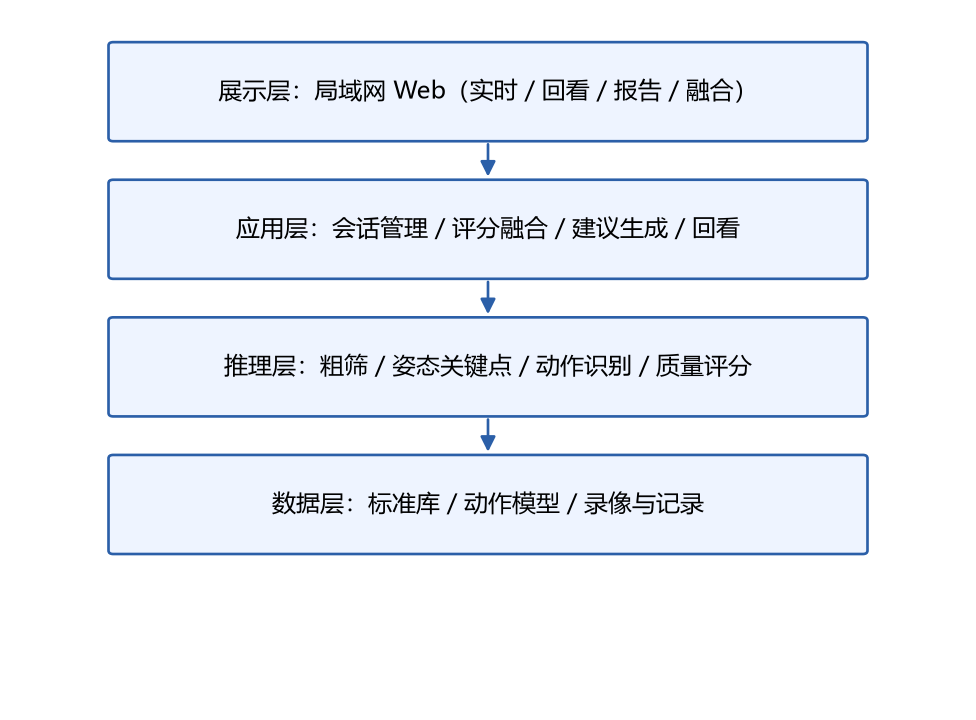
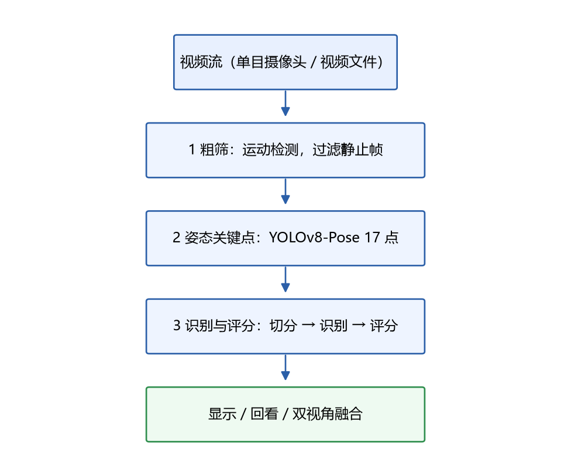
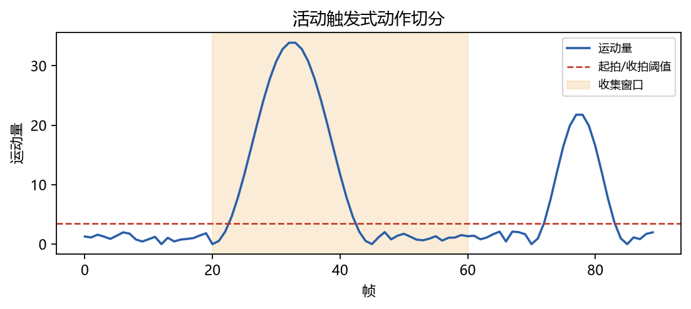
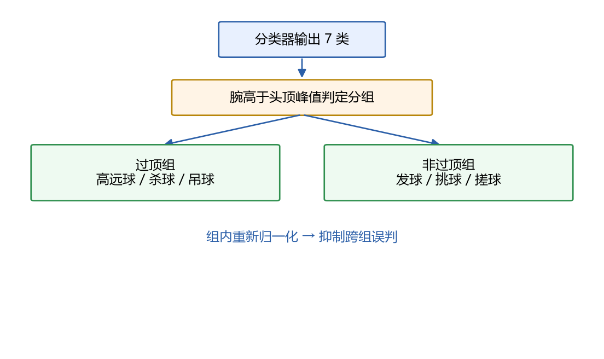
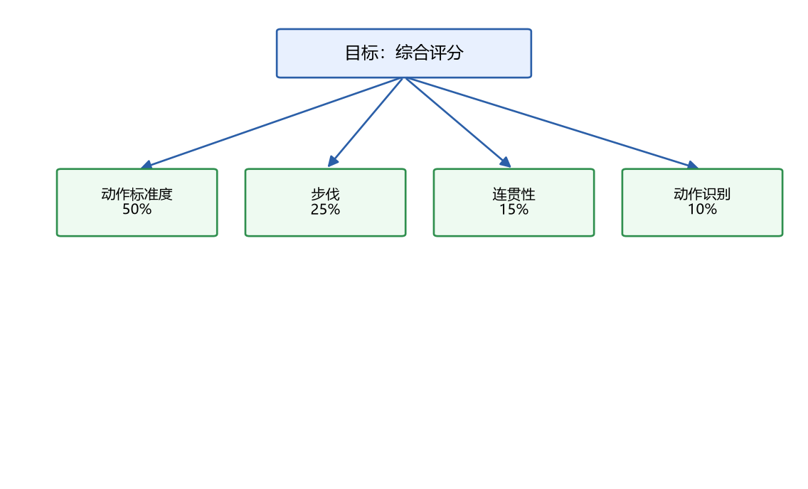
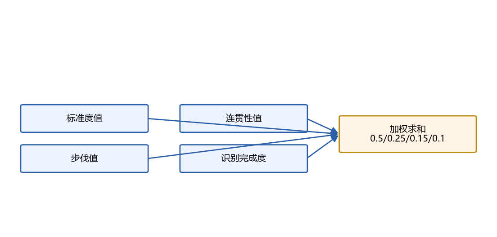
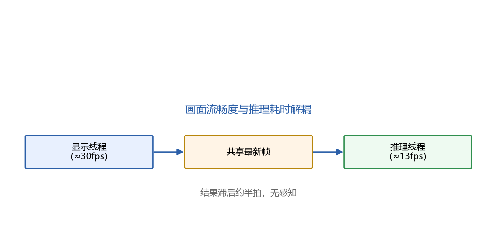
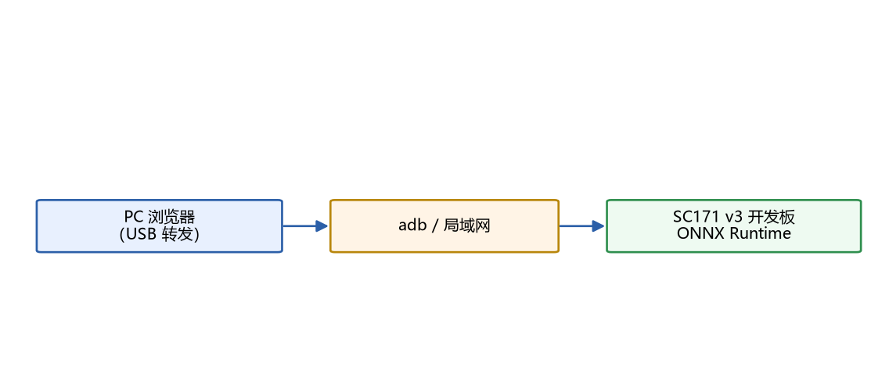
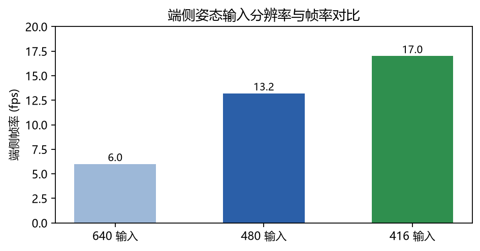
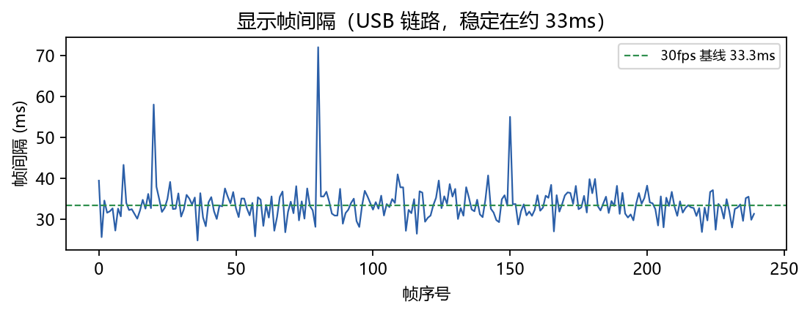

# 基于端侧人工智能的羽毛球动作识别与规范评估系统

> 作品名称：基于端侧人工智能的羽毛球动作识别与规范评估系统
> 作品类别：科技发明制作 A 类
> 完成成员：XXXX、XXXX、XXXX、XXXX、XXXX

---

## 摘要

面向普通人和羽毛球初学者缺乏专业指导、动作难以自查的现实需求，本作品设计并实现了一套
可在开发板端侧离线运行的羽毛球动作识别与规范评估系统。系统以单目摄像头为唯一输入，
不检测羽毛球，仅基于人体 17 个骨架关键点，构建了"粗筛 → 姿态关键点 → 识别与评分"的
三级流水线。在动作识别上，本作品提出活动触发式动作切分方法，逐帧检测挥拍起止、以变长
窗口重采样对齐，解决了传统固定滑窗"一拍多次判定、快慢挥拍难以统一"的工程难题，并引入
过顶/非过顶两阶段分组门控抑制跨组误判；在动作评估上，本作品以 AHP 层次分析法确定
"动作标准度 50%、步伐 25%、连贯性 15%、动作识别 10%"的四项评分权重，把识别置信度设计为
门控而非质量维度，使评分可解释、可追溯。系统在广和通 SC171 v3（高通 QCM6490，aarch64
Linux）开发板上完成部署：采用 ONNX Runtime 纯 CPU 推理，显示与推理分离后画面稳定在约
30fps、动作分析约 13fps，无需 GPU/NPU 即可实时运行，并通过局域网 Web 界面提供实时反馈、
历史回看与双视角融合评估。作品具备端侧本地、低硬件成本、可解释评分与完整自研链路等
特点，可服务于体校教学、校园体育、居家训练等场景，并具备向其他运动动作分析迁移的推广价值。

**关键词**：羽毛球；人体姿态估计；动作识别；端侧人工智能；可解释评估

---

---

# 第 1 章 绪论

## 1.1 研究背景与意义

### 1.1.1 羽毛球运动的普及与动作规范的重要性

羽毛球是我国参与人数最多、群众基础最广的运动项目之一。它上手门槛低、对场地要求不高，
但真正"打好"却极难：羽毛球的绝大多数技术动作都要求全身协调发力，由下肢蹬转带动躯干、
再经肩、肘、腕形成鞭打式用力，任何一个环节的错误都会显著降低出球质量，甚至造成运动损伤。
以最基础的后场高远球为例，规范动作要求击球点在身体前上方、手臂接近伸直、充分转体送髋；
而初学者最常见的问题恰恰是"只用手臂、屈肘击球、击球点靠后"。这些问题在自我练习时极难被
本人察觉，因为动作发生在零点几秒之内，人无法一边发力一边观察自己。

### 1.1.2 专业指导的稀缺与成本

动作规范的最佳获取方式是专业教练的现场指导。但现实中，专业羽毛球教练数量有限、费用较高，
且指导时间高度依赖人与人之间的档期。对于绝大多数普通爱好者和初学者而言，"有教练看着练"
是可望而不可即的：他们要么在没有反馈的情况下重复错误动作（越练越错），要么只能靠手机录像
后自己回看，而普通人缺乏判断动作对错的知识，录像回看往往看不出问题所在。

### 1.1.3 人工智能带来的可能

计算机视觉中的**人体姿态估计**技术，能够从单张图像或视频中定位人体的关节关键点（如肩、肘、
腕、髋、膝、踝等）。这使得"用机器看懂人体动作"成为可能：只要拿到一段关键点轨迹，就可以
定量地分析动作的角度、幅度、节奏与规范程度。叠加**骨架动作识别**，还可以判断"这一拍是什么
动作"。把这套能力放到**摄像头 + 边缘计算设备**上，就能做出一个"随身教练"：不联网、低成本、
随时可用，把专业教练的判断标准下沉到设备端。

本作品正是沿着这条思路，做出一套从模型训练到端侧部署的完整系统。

## 1.2 国内外研究与应用现状

### 1.2.1 人体姿态估计

人体姿态估计已从早期基于图结构的自底向上方法（OpenPose）发展到单阶段、实时、高精度的
方法。以 YOLO 系列为代表的单阶段检测框架在姿态估计任务上表现突出：YOLOv8-Pose 能在单次
前向推理中输出人体框、置信度与 17 个 COCO 关键点，模型小、速度快，非常适合端侧部署。
MediaPipe Pose 等轻量方案在移动端也被广泛使用。近年来还出现了面向羽毛球场景的改进工作，
如通过局部注意力增强的 YOLOv8-Pose 变体，说明"用通用姿态模型 + 场景适配"是一条被验证的路径。

### 1.2.2 骨架动作识别

骨架动作识别的主流方法是基于图卷积网络（ST-GCN 及其多流变体）和基于循环网络的时序建模。
面向羽毛球，已有研究用改进的 ST-GCN 在多个击球类别上取得较高准确率，也有工作用 Transformer
做骨架击球类型识别（如 BST）。这些方法的共同点是：输入是骨架序列，输出是动作类别。
本作品受端侧算力限制，选择了轻量的 GRU 时序分类器作为识别骨干，并在其前后引入特征工程与
分组门控，以在有限算力下获得可用的识别精度。

### 1.2.3 动作质量评估与体育 AI 应用

动作识别回答"这是什么动作"，而**动作质量评估**回答"这个动作做得好不好"。近年出现了把击球
质量拆解为若干可解释的生物力学指标（挥拍速度、腕/肘姿态、轨迹平滑度、步伐效率、拍控等），
再用层级模糊推理给出质量评级的研究框架。这一思路的关键结论是：**动作识别与质量评估应当
解耦**——识别是分类问题，质量是评估问题，二者不宜混在同一个权重里。本作品的评分体系设计
直接采纳了这一结论（详见第 4 章）。

在应用端，市面已有一些运动动作分析类产品，但普遍存在以下特征：依赖云端推理、需要较好的
网络条件；评分为黑盒，用户只知道"分数低"却不知道"错在哪里"；或仅做视频录制与人工回看，
不提供自动分析。这些正是本作品希望改进的地方。

## 1.3 现有方案存在的问题

综合调研，当前面向大众的羽毛球（乃至更广义的运动）动作分析方案存在四类问题：

1. **过度依赖云端**。推理在服务器完成，需要稳定网络与持续上传，既受网络限制，又带来隐私
   顾虑；对场馆等场所的部署不友好。
2. **评分不可解释**。很多产品只给一个总分，缺少"哪一项低、为什么低、怎么改"的说明，对
   学习者帮助有限。
3. **识别与评估混淆**。把"识别出动作类型"直接当作"动作做得好"的依据，导致评分含义不清。
4. **时域切分粗糙**。多数实现用固定长度的滑动窗口逐帧判定，造成同一拍被反复判定，且对
   快慢不同的挥拍缺乏自适应能力。

## 1.4 本作品的目的与基本思路

### 1.4.1 目的

面向普通人与初学者，做出一个**可在边缘设备上离线运行**的羽毛球动作分析系统，实现：

- 击球动作类型识别（7 类）；
- 技术动作规范程度量化评估（四项评分，百分制）；
- 面向个人的可解释改进建议；
- 训练过程的历史回看；
- 全程本地运行、无需联网、硬件成本低。

### 1.4.2 基本思路

系统自始至终以"端侧可部署"为约束进行设计，采用三级流水线：

1. **粗筛**：对视频流做轻量运动判断，避免无意义帧进入后续重计算；
2. **姿态关键点**：用 YOLOv8-Pose 提取人体 17 个关键点，只做"人"，不检测羽毛球，从源头
   降低问题复杂度；
3. **识别与评分**：把关键点轨迹转成尺度/位置不变的特征，经活动触发式切分后送入轻量分类器，
   再结合标准库做四项评分与建议生成。

与"先做重模型再想办法部署"的常见路径不同，本作品在特征设计、模型选型、推理运行时、
线程与分辨率配置等每一环都优先考虑端侧约束，最终在同一套算法下同时支持 PC 端（开发调试）
与开发板端（部署运行）两种入口。

## 1.5 主要工作与创新点

本作品完成的主要工作：

1. 完成从数据准备、特征工程、模型训练、评估到 ONNX 导出与端侧部署的完整闭环；
2. 提出并实现**活动触发式动作切分**，解决固定滑窗"一拍多次判定、快慢难统一"的问题；
3. 设计**过顶/非过顶两阶段分组门控**，抑制跨组误判；
4. 用 **AHP 层次分析法**论证并确定四项评分权重，引入识别门控，使评分可解释；
5. 在 SC171 v3 上完成 **ONNX Runtime 纯 CPU 部署**，并通过"显示与推理分离"把显示帧率从
   约 12.5fps 提升到约 30fps；
6. 实现局域网 Web 端的实时反馈、历史回看与双视角融合评估。

创新点集中在：端侧离线、可解释评分、活动触发式切分与完整自研链路（详见第 3 章）。

## 1.6 论文/报告结构安排

第 2 章介绍相关技术与理论基础；第 3 章给出系统总体设计与技术选型；第 4 章详述关键技术
实现；第 5 章说明数据与模型训练；第 6 章介绍端侧部署与性能优化；第 7 章给出测试与结果；
第 8 章分析应用价值与推广路径；第 9 章总结并展望。

## 1.7 羽毛球七类技术动作详解与规范要点

本作品要评估的对象是具体的羽毛球技术动作，因此有必要先把这七类动作的技术要领与常见
错误讲清楚——它们正是评分规则与建议库的来源。以下按"动作特征—关键要领—常见错误"
逐类说明。

### 1.7.1 正手发高远球

以正手握拍，抛球于身体右前方，腰以下击球，把球发到对方后场底线附近。

- 关键要领：击球点在腰以下；重心由后脚向前脚转移；击球后向前上方充分随挥；抛球稳定、
  落点一致。
- 常见错误：抛球不稳（忽高忽低、忽左忽右）；击球点过高（高于腰，属发球违例风险）；
  挥拍不完整、击完就停；重心不转移，只用手臂发力。

### 1.7.2 反手发网前小球

以反手握拍，拍头低于腰，短促推击，使球贴网过网、落于对方前发球线附近。

- 关键要领：拍头必须低于腰（违例线）；动作紧凑、靠手腕手指短促发力；出球高度低、
  贴网过。
- 常见错误：拍头高于腰（违例风险）；出球过高（给对手扑杀机会）；手腕僵硬、动作过大。

### 1.7.3 后场高远球

后场正手（或头顶）把球打到对方后场底线附近，是单打中最基础也最重要的后场球。

- 关键要领：击球点在身体前上方、接近头顶正上方；手臂接近伸直、充分抬肘；转体送髋，
  由下肢蹬转带动；击球后完整随挥。
- 常见错误：击球点靠后（在头顶后方击球）；屈肘击球、不抬肘（"用胳膊打"）；
  疑似翻腕（用腕过多）；重心后仰；引拍不充分。

### 1.7.4 杀球

在尽可能高的击球点上，以快速下压的方式把球打进对方场内，是最具攻击性的技术。

- 关键要领：击球点高且靠前；充分转体、以躯干带动上肢；挥拍速度快、下压明显；
  随挥向下、重心跟进。
- 常见错误：击球点偏低；压腕过早（发力时机不对）；重心后仰（"后倒"）；
  只用手臂、不转体。

### 1.7.5 吊球

引拍动作与高远球一致，但在击球瞬间减速、切击，使球贴网下落到对方前场。

- 关键要领：击球点与高远球一致（前上方）；引拍动作保持一致（与高远球难以区分）；
  击球瞬间拍速放慢、切击；手腕控制落点。
- 常见错误：击球点不稳定；拍面控制差、球过高；动作与高远球差异过大（容易被预判）。

### 1.7.6 挑球

在网前低位把球由下向上挑到对方后场，是防守反击的常用手段。

- 关键要领：低位引拍；由下向上跟送、以肘带动；手腕前臂发力；步伐到位。
- 常见错误：屈肘发力、动作僵硬；挑球高度不足（被对手扑杀）；脚下不到位、够着打。

### 1.7.7 搓球

在网前用拍面小幅度切托，使球翻滚贴网而过，是网前控制技术。

- 关键要领：上步迎前、手臂前伸靠近网口；小幅度切托；靠手腕手指捻动；击球点尽量高。
- 常见错误：动作过大（搓成挑球）；拍面太平、角度不当；手腕僵硬、触球过重。

### 1.7.8 由动作特征到评分检查点

上述要领并不能直接被程序使用，需要转化为"特征空间"里可测量的量。本作品据此为每类动作
选取若干角度检查点与错误规则，例如：

| 动作 | 主要检查点（特征） | 主要错误规则 |
| --- | --- | --- |
| 高远球 | 上臂抬角、肘角、腕高于头 | 屈肘、击球点偏低或低于头顶 |
| 杀球 | 上臂抬角、肘角、重心比例 | 屈肘、击球点偏低、重心未跟进 |
| 吊球 | 上臂抬角、腕高于头 | 击球点偏低 |
| 挑球 | 上臂抬角、肘角、腕相对肩高 | 击球点过高、肘部僵硬 |
| 搓球 | 上臂抬角、腕前伸 | 离网太远、动作过大 |
| 正手发高远球 | 上臂抬角、肘角、腕相对肩高 | 击球点过高、随挥不足 |
| 反手发网前小球 | 上臂抬角、肘角、腕相对肩高 | 拍头过高、动作过大 |

这张表是"技术要领（定性）"与"评分规则（定量）"之间的桥梁，也是标准库第二层（角度区间）
统计的对象。它体现了本作品的一个基本立场：**评分规则不是凭空设定，而是从动作要领推导
出来的可测量量**。

---

## 1.8 选题背景与方向的契合性

本作品的选题契合两层背景。其一是**国家战略与产业方向**：体育强国与全民健身是明确的政策
导向，人工智能与各行业深度融合（"人工智能+"）是产业升级的主线，而"具身/智能感知 + 民生
体育"正处在两者交汇处。本作品把人工智能落到"让普通人也能得到规范动作指导"这一具体民生
场景上，方向明确、落点具体。

其二是**技术条件的成熟**：人体姿态估计与端侧推理这两项关键技术近年已足够成熟、足够轻量，
使得"在低成本设备上离线做人+关键点分析"从不可能变为可行。本作品不是去追逐最前沿的模型，
而是把已经成熟的技术组合成一件对普通人有用的东西——这恰恰是"科技发明制作"所看重的
"应用价值与转化前景"。

# 第 2 章 相关技术与理论基础

## 2.1 人体姿态估计

### 2.1.1 COCO 17 关键点模型

本作品采用 COCO 定义的 17 个人体关键点：鼻、左/右眼、左/右耳、左/右肩、左/右肘、左/右腕、
左/右髋、左/右膝、左/右踝，编号 0~16。每个关键点包含 (x, y, confidence) 三个分量。
选择 17 点而非全身 133 点模型，是出于端侧算力与羽毛球动作分析需求的权衡：羽毛球的技术
规范主要体现于躯干与四肢大关节的角度与相对位置，17 点已足够；更细的手部关键点对端侧
代价过高，且在本作品"不检测球拍与球"的定位下意义有限。

### 2.1.2 YOLOv8-Pose

YOLOv8-Pose 是单阶段检测框架直接输出人体姿态的模型。其单次前向即可得到人体框、置信度与
关键点，并可在导出时融合 NMS，得到固定形状的输出（本作品为 (1, 300, 57)：300 个候选 ×
57 维，含框、置信度、类别与 17×3 关键点）。模型体量小（yolov8n 约 3.3M 参数），在 CPU 上
也可实时，非常适合本作品"端侧纯 CPU"的约束。

## 2.2 骨架动作识别

骨架动作识别把随时间变化的关键点序列映射为动作类别，主流方法包括：

- **图卷积方法（GCN 系）**：把骨架建模为图，用空间图卷积建模关节关系、时序卷积建模运动，
  代表为 ST-GCN 及其多流/注意力增强变体，精度高但算力需求较大；
- **循环网络方法（RNN/GRU/LSTM）**：把骨架序列按时间展开，逐帧更新隐状态，模型轻、易在
  CPU 上训练与部署；
- **Transformer 方法**：用自注意力建模长程时序依赖，精度高、参数多。

本作品在端侧算力约束下选择**轻量 GRU 时序分类器**作为识别骨干：输入为 (T, F) 的特征序列
（T 为窗口帧数，F 为特征维度），输出为各类别的 logits。为弥补轻量模型的表达力不足，本作品
在模型之外引入了特征工程（第 4.2 节）、活动触发式切分（第 4.3 节）与分组门控（第 4.4 节）。

## 2.3 尺度与位置不变的动作特征

直接把关键点坐标送进模型会受到相机距离、身高、站位的影响：同一个人离镜头远近变化时，
像素坐标差异极大，但动作其实没变。为此本作品把关键点加工成一组尺度/位置不变的特征，
由两类量组成：

- **关节角度**：如肘角（肩-肘-腕三点夹角）、上臂抬角（躯干-肩-肘）、膝角、髋角、
  躯干倾角等。角度由三点确定，与点在图像中的绝对位置无关，因此对相机远近不敏感。
- **归一化相对位置**：如腕相对肩的高度、腕前伸距离、头前伸距离、两踝间距等，均除以
  肩宽（退化时用躯干长）归一化，因此对身高与距离不敏感。

这两类量既对场景变化稳健，又能直接对应到"动作是否规范"的直观概念（如"抬肘够不够"
对应上臂抬角），因而同时用于识别与评分——识别模型吃这组特征，评分规则也从这组特征
读取检查点。这种"识别与评分共用中间表示"的设计，是本作品可解释性的基础。

## 2.4 时序动作切分

一段连续视频里"有效动作"只占很小一部分，如何把它切出来是识别的前提。常见做法是固定
长度的滑动窗口：窗口每前进一帧就判定一次。这种做法在羽毛球场景有两类问题：一是同一拍
会被反复判定（结果不稳定），二是固定窗长无法同时适配快拍与慢拍。

本作品提出"活动触发式切分"：逐帧计算运动量，检测挥拍的"开始"与"结束"，只在起止之间
收集帧，再把变长窗口重采样到固定长度后识别。相比固定滑窗，它在机制上保证了一拍只出
一个结果，并天然支持不同速度的挥拍（详见第 4.3 节）。

## 2.5 评价方法与层次分析法（AHP）

动作评估需要"多维度加权"。为避免主观拍脑袋定权重，本作品采用层次分析法（AHP）：把
决策问题分解为目标层、准则层与方案层；对同层各准则两两比较，构造判断矩阵；用几何
平均法求权重；再用一致性比率（CR）检验判断矩阵是否自洽（一般要求 CR < 0.1）。

AHP 的价值在于过程透明、可复现、有量化依据，适合作为"可解释评分"的权重来源。本作品
用它确定四项评分的权重（第 4.5 节），并给出完整的一致性检验结果，使"为什么标准度占
一半"这类问题有据可查，而不是一句"经验估计"。

## 2.6 端侧推理与 ONNX Runtime

要在开发板上运行，训练得到的 PyTorch 模型需先导出为 ONNX，再由 ONNX Runtime 加载推理。
ONNX 是跨框架的模型交换格式，ONNX Runtime 是面向推理的高性能引擎。两者结合的好处是：

- **与训练框架解耦**：端侧无需安装沉重的 PyTorch/Ultralytics；
- **跨平台**：同一份模型可在 x86 的 PC 与 aarch64 的开发板上运行；
- **可控**：可显式设置线程数、图优化级别等，便于在大小核异构的芯片上调优。

本作品把姿态模型与动作分类器都导出为 ONNX，从而在同一套算法逻辑下支持 PC（torch）与
开发板（onnx）两个入口（详见第 6 章）。

## 2.7 现有方案对比与技术指标综述

为明确本作品的位置，这里把典型方案按"推理位置 / 评分可解释性 / 时域切分 / 硬件成本 /
隐私性"五个维度对比：

| 方案类型 | 推理位置 | 评分可解释 | 时域切分 | 硬件成本 | 隐私 |
| --- | --- | --- | --- | --- | --- |
| 纯人工录像回看 | 无 | 依赖人 | 无 | 低 | 好 |
| 云端动作分析 App | 云端 | 多为黑盒总分 | 固定滑窗 | 中（需网络） | 需上传 |
| 专业动作捕捉设备 | 本地/工作站 | 指标丰富 | 高精度 | 很高 | 好 |
| 本研究 | 端侧 | 规则+角度可追溯 | 活动触发式 | 低（单摄+板） | 视频不出设备 |

可以看到，本作品在"低成本 + 端侧 + 可解释"这一组合上具有明显差异化的定位：既不像云端
方案那样依赖网络与上传，也不像专业动捕那样昂贵，同时保留了对动作的量化评估能力。

## 2.8 关键技术指标的定义

为便于后文表述，先约定几个贯穿全文的指标定义：

- **显示帧率**：浏览器画面每秒更新次数，反映"看起来流不流畅"；
- **分析帧率**：识别与评分结果每秒更新次数，反映"分析有多及时"；
- **运动量**：相邻两帧之间持拍臂上抬角、腕相对肩高、腕前伸三项变化绝对值之和，是切分
  与门控的基础量；
- **挥速**：运动量的时间序列，其峰值对应击球瞬间的快速挥拍；
- **置信度**：分类器输出经 softmax（或组内归一化）后的最大类别概率，反映识别把握程度。

区分"显示帧率"与"分析帧率"很重要：本作品通过将二者解耦，使画面流畅度不受分析耗时影响，
这也是后文性能优化的一条主线。

---

## 2.9 相关开源生态与工具链

本作品建立在一套成熟的开源生态之上，选择这些工具既是为了工程效率，也是为了端侧部署的
可控性。这里对主要依赖及其作用做一说明。

| 工具/库 | 作用 | 选型考量 |
| --- | --- | --- |
| Ultralytics | YOLOv8-Pose 训练/推理/导出 | 生态成熟、导出 ONNX 方便 |
| PyTorch | 分类模型训练 | 训练灵活、CPU 可跑 |
| ONNX / ONNX Runtime | 跨框架模型格式与端侧推理 | 与训练解耦、无需 GPU |
| OpenCV | 视频采集、图像处理、JPEG 编码 | 功能全、稳定 |
| NumPy | 特征与数值计算 | 基础库 |
| FastAPI / Uvicorn | Web 服务与接口 | 轻量、异步、上手快 |
| pytest / unittest | 单元测试 | 保证核心逻辑正确 |

在"训练框架（PyTorch）"与"端侧运行时（ONNX Runtime）"之间用 ONNX 作为桥梁，是本作品
"一套算法、两个入口"得以实现的关键：训练出来的模型导出为 ONNX 后，PC 与开发板都能以
同一份权重运行，避免"训练一套、部署另一套"带来的偏差与维护成本。

## 2.10 评价指标

为客观衡量系统，本作品采用以下指标：

- **识别准确率**：整体与分类别的正确率；
- **混淆矩阵**：观察哪些类别容易被互相误判（如高远球与吊球）；
- **显示帧率与分析帧率**：反映实时性；
- **推理单次耗时**：反映算力开销；
- **切分正确性**：单拍/多拍/静止场景下产出结果的个数是否符合预期；
- **稳定性指标**：长时间运行的内存与线程数是否稳定。

其中识别准确率与混淆矩阵用于评估"识别得对不对"，显示/分析帧率与推理耗时用于评估
"跑得快不快"，切分正确性与稳定性指标用于评估"结果稳不稳"，三者共同刻画系统的可用性。

---

## 2.11 常用数据集与标注格式

面向"人 + 关键点"的动作识别，常见的数据组织方式有两类：一类是**骨架标注数据集**，直接
给出逐帧关键点与动作标签（适合识别训练）；另一类是**原始视频数据集**，需要自行跑姿态
提取（灵活但成本高）。本作品两条都用：公开骨架数据用于识别训练，自采原始视频经统一管线
转成骨架特征后接入。

在标注格式上，本作品采用"以击球帧为中心的固定长度窗口"约定，与常见骨架动作识别数据集
一致；同时为适配端侧实时，额外定义了"活动触发窗口"（第 4.3 节）。两种窗口的关系是：
离线训练用前者保证与公开数据可比，在线推理用后者保证实时与稳定，二者通过"同一套切分"
在工程上统一（第 5.6 节）。

# 第 3 章 系统总体设计


## 3.1 需求分析

### 3.1.1 功能需求

| 编号 | 功能 | 说明 |
| --- | --- | --- |
| F1 | 实时训练 | 摄像头持续输入，实时给出击球类型、评分与即时建议 |
| F2 | 录像分析 | 对已录制视频离线分析，输出完整结果 |
| F3 | 动作类型识别 | 判断每一拍的击球类型（7 类） |
| F4 | 动作规范评估 | 按四项指标综合打分，并针对低分项给出建议 |
| F5 | 回看 | 保存每一拍的结果与代表帧，可检索、逐帧回放 |
| F6 | 局域网 Web 查看 | 浏览器查看实时画面、结果与历史 |
| F7 | 双视角评估 | 正面与侧面分时采集，结果融合 |

### 3.1.2 非功能需求

- **端侧可部署**：能在开发板上离线运行，不依赖云端；
- **实时性**：画面流畅、分析结果及时；
- **可解释性**：每一项分数与建议都能追溯到具体指标或规则；
- **低成本**：单摄像头 + 开发板即可，不依赖高性能 GPU；
- **可迁移性**：框架可用于其他运动动作分析。

### 3.1.3 边界与取舍

本作品明确只做"人 + 关键点"，**不检测羽毛球**。这是关键的工程取舍：球体小、速度快、
遮挡严重，检测成本高且稳定性差；而绝大多数技术动作的规范性可以从人体骨架本身评估。
放弃球的检测，换来的是系统复杂度、算力需求与部署难度的显著下降，同时保留了核心的
"动作识别 + 规范评估"能力。相应地，"出球落点、出球质量"这类需要球轨迹的指标不纳入评分，
评分只围绕人体动作本身展开。

## 3.2 三级流水线架构

系统采用"粗筛 → 姿态关键点 → 识别与评分"的三级流水线：

```text
视频流（单目摄像头 / 视频文件）
  └─► 1. 粗筛：运动检测，过滤静止帧，避免无意义帧进入重计算
         └─► 2. 姿态关键点：YOLOv8-Pose 提取人体 17 点（只做人）
                └─► 3. 识别与评分：
                       ├─ 特征提取（尺度/位置不变的 15 维特征）
                       ├─ 活动触发式切分（起止检测 + 变长窗口重采样）
                       ├─ 动作识别（GRU + 过顶/非过顶分组门控）
                       ├─ 四项评分（标准度/步伐/连贯性/动作识别）
                       ├─ 建议生成（规则 + 错误清单）
                       └─ 显示 / 回看 / 双视角融合
```

这三级的分工原则是：**越往后的环节越"重"，越要靠前的环节越"轻"**。粗筛与切分都是极廉价的
运动量判断，却能把大量无效帧挡在分类器之外，从而在有限算力下获得实时性。





## 3.3 两种运行入口

系统核心算法完全共用，仅推理运行时不同，做成两个运行入口：

- **PC 端（torch）**：姿态与分类用 PyTorch 跑，便于开发、调试与训练验证；
- **开发板端（onnx）**：姿态与分类用 ONNX Runtime 跑，面向端侧部署。

两者共用同一套特征、切分、识别与评分逻辑，因此 PC 上验证通过的行为可原样迁移到板端。

## 3.4 技术选型

| 模块 | 选型 | 理由 |
| --- | --- | --- |
| 开发语言 | Python | 生态完善，训练与部署统一 |
| 图像处理 | OpenCV | 成熟的视频采集与图像处理库 |
| 姿态检测 | YOLOv8-Pose（17 点 COCO） | 单阶段实时、模型小、易端侧部署 |
| 动作识别 | 轻量 GRU 时序分类 | CPU 可训练可部署，配合特征工程与门控 |
| 端侧推理 | ONNX Runtime（CPU） | 与训练框架解耦、跨平台、无需 GPU |
| 后端服务 | FastAPI + Uvicorn | 轻量、异步、易于实现 MJPEG 与接口 |
| 实时预览 | MJPEG over HTTP | 实现简单、兼容性好 |
| 前端 | 原生 HTML/JS | 无额外依赖，单文件部署 |

## 3.5 软硬件环境

- **开发/训练环境**：Windows PC，Python 3.11 虚拟环境，PyTorch、Ultralytics、OpenCV；
- **端侧环境**：广和通 SC171 v3（高通 QCM6490，aarch64，Linux 内核 5.4，Python 3.8），
  ONNX Runtime 1.19，OpenCV（headless），FastAPI/Uvicorn；
- **输入设备**：杰锐微通 USB 摄像头（板端为 /dev/video2），单目、720p/480p；
- **连接方式**：USB（adb 端口转发）或局域网 WiFi，均为本地链路。

## 3.6 数据流与模块接口

系统内部的数据流可抽象为"帧 → 关键点 → 特征 → 窗口 → 结果"的逐级加工，各模块之间通过
统一的数据结构衔接，保证可替换、可测试。

| 阶段 | 输入 | 输出 | 说明 |
| --- | --- | --- | --- |
| 采集 | 摄像头/视频 | 图像帧 | 单目、连续 |
| 姿态 | 图像帧 (H,W,3) | 关键点 (17,3) | 坐标 + 置信度 |
| 特征 | 关键点 (17,3) | 特征 (F,) | 尺度/位置不变 |
| 切分 | 特征序列 | 窗口 (T,F) | 活动触发式 |
| 识别 | 窗口 (T,F) | 类别 + 置信度 | GRU + 门控 |
| 评分 | 击球帧特征 + 类别 | 四项分 + 总分 | 规则 + AHP |
| 建议 | 类别 + 分数 + 错误 | 建议列表 | 规则映射 |
| 展示 | 帧 + 结果 | Web 页面 | MJPEG + 接口 |

采用这种"层层解耦"的数据流有几个好处：(1) 每一级都能单独做单元测试；(2) 更换某一级
（例如更换姿态模型或分类骨干）不影响其他级；(3) 训练与推理可复用同一套中间环节，
保证一致性。

## 3.7 关键设计决策与权衡

本作品在若干处做了刻意的设计取舍，列于此以便评审理解：

| 决策 | 取舍 | 理由 |
| --- | --- | --- |
| 只做人、不检测球 | 放弃落点/出球质量 | 球检测成本高、稳定性差；骨架已可评估规范 |
| 通用 YOLOv8-Pose | 不做场景微调 | 通用模型足够、易维护；精度问题用后处理弥补 |
| 轻量 GRU | 不用 ST-GCN/Transformer | 端侧 CPU 算力约束；用特征工程+门控补表达力 |
| 规则评分 | 不用端到端打分网络 | 可解释、可追溯（竞赛与教学都看重可解释） |
| 端侧 ONNX | 不用云端 | 离线、隐私、低成本、无边带宽依赖 |
| 单目分时双视角 | 不用双目同步 | 单摄像头成本低；分时采集即可融合 |
| 显示与推理分离 | 增加一个线程 | 用少量复杂度换取画面流畅度 |

这些决策共同塑造了本作品"低成本、端侧、可解释、可迁移"的整体形态。

---

## 3.8 典型使用时序与状态机

为便于理解系统在一次使用中的行为，这里给出典型时序与内部状态机。

典型时序：用户站到镜头前 → 系统检测到人体并采集关键点 → 用户完成一次挥拍 → 系统检测
"挥拍开始"并收集帧 → 检测"挥拍结束"并切出一拍 → 识别动作类型 → 结合标准库评分并生成
建议 → 前端显示结果并锁存为"当前这一拍" → 用户点"记录正面/侧面"或继续下一拍 → 训练
结束后查看回看与报告。

系统内部维护一个三态状态机：

| 状态 | 含义 | 进入条件 | 退出条件 |
| --- | --- | --- | --- |
| 空闲 | 未检测到有效挥拍 | 初始/结果超时 | 连续运动达到起拍条件 |
| 收集中 | 正在收集一次挥拍的帧 | 起拍触发 | 收拍触发或达窗口上限 |
| 已出结果 | 已产出一拍结果 | 窗口分析完成 | 超时或下一拍开始 |

这三态对应前端的三种显示："无有效动作""正在分析""当前这一拍"。将状态显式化，既让用户
清楚系统在做什么，也让"结果为什么出现/消失"变得可解释。


## 3.9 系统边界与"不做的事"

明确边界与明确功能同样重要。本作品主动"不做"若干事，以保证在有限资源下把核心做扎实：

1. **不检测羽毛球**。放弃球轨迹，换取复杂度与算力的大幅下降；相应地也不评估落点与出球质量。
2. **不做全场跑动分析**。步伐只评估镜头前的专门动作（重心转移、步幅），不追求全场覆盖。
3. **不做多人体（双打）分析**。首期按单人设计，保留向后扩展的可能。
4. **不做云端。** 全部本地运行，不引入服务器与上传链路。
5. **不做端到端打分网络。** 评分保持规则化、可解释，不用黑盒回归模型。

这些边界并非能力不足，而是"以端侧可用为第一约束"的主动选择：每放弃一项非核心能力，
就把省下来的复杂度与算力投到核心的"识别准、评分清、跑得动"上。

# 第 4 章 关键技术实现

本章是作品的核心，逐项说明关键技术。所有参数取值均来自实际实现与实测。

## 4.1 姿态检测与预处理

### 4.1.1 单帧推理与 Letterbox

对每一帧，先按长边缩放到固定输入尺寸 S（本作品提供 480 与 416 两档，默认 480），短边等比
缩放后补边到 S×S，得到网络输入；推理输出为 (1, 300, 57)，其中每行含 [x1, y1, x2, y2,
置信度, 类别, kpts(17×3)]。对置信度低于阈值（默认 0.3）的候选行予以丢弃，其余行的关键点
坐标再按 letterbox 的缩放比 r 与补边 (pad_w, pad_h) 反算回原图像素坐标，并裁剪到图像范围内。

采用 letterbox 而非直接拉伸，是为了在不改变人体长宽比的前提下适配网络的方形输入，
避免因拉伸引入额外的姿态形变误差。

### 4.1.2 多人场景

当前定位为单人训练，默认取首个/面积最大的人体。骨架叠加绘制仅使用置信度高于 0.2 的
关键点连线，保证画面显示的稳健性。

## 4.2 特征提取

### 4.2.1 设计原则

特征必须同时满足两点：(1) 对相机距离、身高、站位不敏感，保证跨场景可用；(2) 可解释，
能直接对应到"动作规范"的直观概念。为此本作品采用两类特征：**关节角度**（对远近不敏感）
与**以肩宽归一化的相对位置**（对身高不敏感）。

### 4.2.2 15 维特征

| 序号 | 名称 | 含义 | 视角敏感性 |
| --- | --- | --- | --- |
| 0 | arm_raise | 持拍臂上抬角（躯干-肩-肘） | 侧面更可靠 |
| 1 | elbow | 持拍臂肘角（肩-肘-腕） | 正/侧均可 |
| 2 | knee | 持拍侧膝角（髋-膝-踝） | 正面更可靠 |
| 3 | hip | 持拍侧髋角（肩-髋-膝） | 侧面更可靠 |
| 4 | trunk_lean | 躯干相对竖直方向的前倾角 | 侧面 |
| 5 | shoulder_turn | 双肩连线倾斜角（近似转体） | 正面 |
| 6 | com_ratio | 重心水平偏移（髋中点相对踝中点 / 身高） | 正面 |
| 7 | wrist_above_shoulder | (肩高 - 腕高) / 肩宽 | 侧面 |
| 8 | wrist_reach | \|腕 x - 肩 x\| / 肩宽 | 侧面 |
| 9 | wrist_above_head | (头顶 - 腕高) / 肩宽 | 侧面 |
| 10 | head_forward | (头 x - 髋中点 x) / 肩宽 | 侧面 |
| 11 | ankle_width | 两踝间距 / 肩宽 | 正面 |
| 12 | non_dom_elbow | 非持拍臂肘角 | 正/侧 |
| 13 | non_dom_arm_raise | 非持拍臂上抬角 | 正/侧 |
| 14 | non_dom_knee | 非持拍侧膝角 | 正面 |

其中 0~6 为角度/重心类，7~11 为腕、头、踝的相对位置类，12~14 为非持拍侧（用于评估
平衡与协调，也提供与持拍侧的对比信息）。

### 4.2.3 缺失值处理

当关键点置信度为 0 或缺失时，对应特征置为 NaN。训练阶段沿时间轴做线性插值填补；推理
阶段则对 NaN 归零处理，避免污染特征。

### 4.2.4 时间导数特征（可选扩展）

为区分"高远球 vs 吊球"这类主要差异在挥拍快慢上的动作，本作品在 15 维静态特征之外，
实现了可选的**时间导数特征**（对腕相对肩高、腕前伸、腕高于头、上臂抬角四项沿时间求一阶
与二阶差分），形成 23 维特征。该扩展通过训练脚本开关启用，供后续在真实数据充足时使用。

## 4.3 活动触发式动作切分

### 4.3.1 问题

固定长度滑动窗口逐帧判定的做法，会导致同一拍被反复判定（结果抖动），且固定窗长无法同时
适配快拍与慢拍。用户在实测中反馈"同一动作时而识别得到、时而不稳定"，根源即在此。

### 4.3.2 方法

本作品提出活动触发式切分，分为四步：

1. **逐帧运动量**：对相邻两帧计算持拍臂上抬角、腕相对肩高、腕前伸三项变化的绝对值之和，
   作为该帧的"运动量"。
2. **起拍检测**：连续 3 帧运动量不低于阈值（默认 3.5）时，判定"挥拍开始"，开始收集帧。
3. **收拍检测**：连续 5 帧运动量低于阈值时，判定"挥拍结束"；另设窗口上限（默认 90 帧）
   兜底，防止连续动作时无限收集。
4. **窗口对齐**：把收集到的变长窗口沿时间轴线性重采样到固定长度 T（默认 24 帧），
   再送入识别。若窗口明显过长（超过 2T），则取挥速峰值附近的 T 帧，避免把整段连续动作
   压缩进一个窗口。

### 4.3.3 关键改进

- **快慢自适应**：快拍窗口短、慢拍窗口长，重采样后统一到同一时间轴，解决了固定窗长
  对快慢挥拍不通用的问题。
- **一拍一次**：一次起止只产生一个窗口、一次识别结果，从机制上消除了"一拍多次判定"。
- **省算力**：分类器只在收拍时运行一次，而不是每帧运行。
- **安全闸**：收拍后对原始帧计算平均挥速，低于阈值（默认 2.0）则判为"纯抖动"丢弃，
  避免站立时因关键点抖动而误触发；在数据准备（自采入库）路径中，该阈值放宽到挥速峰值
  层面，避免小幅度的反手发球、搓球被丢弃。

### 4.3.4 与数据准备的一致性

该切分逻辑在"运行时分析"与"自采数据入库"两条路径中使用**完全相同**的实现，保证训练数据
的窗口分布与推理时的窗口分布一致，避免"训练用一套、部署用另一套"导致的精度下降。



## 4.4 动作识别与分组门控

### 4.4.1 识别类别

系统识别 7 类击球动作：正手发高远球、反手发网前小球、高远球、杀球、吊球、挑球、搓球。

### 4.4.2 识别骨干

识别骨干为轻量 GRU：输入 (T=24, F=15) 的特征序列，经两层 GRU（隐层 96）后取末帧隐状态，
经 LayerNorm 与线性层输出 7 类 logits，softmax 后取 Top-K。模型体量小、CPU 上训练与
推理都很快，适合端侧。

### 4.4.3 过顶/非过顶两阶段分组门控

7 类动作可按"击球点高度"粗分为两组：

- **过顶组**：高远球、杀球、吊球（击球点接近或高于头顶）；
- **非过顶组**：正手发高远球、反手发网前小球、挑球、搓球（击球点低于肩/腰）。

工程实践发现，分类器最容易犯的错是"跨组误判"（例如把低位挑球判成杀球）。为此本作品引入
分组门控：先用"整段序列中腕相对头顶高度的峰值"判定该拍属于哪一组（阈值 0.15），再在
**该组的候选类别内**对分类器的 logits 重新归一化（其余类别屏蔽），得到组内归一化的置信度。
这样把分类范围从 7 类收窄到 3~4 类，显著抑制跨组误判。

需要说明的是，门控只解决跨组问题；组内的"高远球 vs 吊球"混淆主要靠更丰富的时间导数特征
与更充分的自采数据解决，属于后续提升方向。

### 4.4.4 两阶段识别的可扩展性

当前的分组门控是一个由特征可直接判定的启发式门控。系统在架构上已支持"用训练得到的分组
分类器替换启发式门控"（分类器接口预留了候选类别掩码），待自采数据到位后即可升级为
真正意义上的两阶段分类模型。



## 4.5 四项评分体系

### 4.5.1 评分维度与权重

系统的综合评分为百分制，由四项加权构成：

| 维度 | 权重 | 含义 |
| --- | --- | --- |
| 动作标准度 | 50% | 技术规范/生物力学质量（角度、关节位置、错误规则） |
| 步伐 | 25% | 步伐效率（重心转移、站距、起动） |
| 连贯性 | 15% | 轨迹平滑度、节奏、动作完整性 |
| 动作识别（完成度） | 10% | 识别置信度加权的完成度 |

综合得分 = 0.50×标准度 + 0.25×步伐 + 0.15×连贯性 + 0.10×动作识别。

### 4.5.2 用 AHP 论证权重

权重的确定不靠主观，而用层次分析法（AHP）。以四个维度为准则层，构造两两比较的判断矩阵
（Saaty 1~9 标度），几何平均法求权重，得到：

| 准则 | 权重（未取整） | 取整 |
| --- | --- | --- |
| 动作标准度 | 0.483 | 50% |
| 步伐 | 0.272 | 25% |
| 连贯性 | 0.157 | 15% |
| 动作识别 | 0.088 | 10% |

一致性检验：λ_max = 4.0145，CI = 0.0048，CR = 0.0054 < 0.1，**通过一致性检验**。

### 4.5.3 关键设计：识别是"门控"不是"质量维度"

早期版本的权重曾设为"标准度 40%、动作识别 40%"，即让识别结果直接主导评分。经文献调研
（见第 2.1.3 节所述的质量评估框架），这一设定被修正为：**动作识别是评分的前提/门控，
而非质量维度**——识别错了动作，后续用标准库比对就失去意义；但"识别得准"并不等于
"动作做得好"。因此本作品把识别权重降到 10%，并引入**识别门控**：当识别置信度低于 0.5 时，
动作识别维度得分再打五折，视为"完成度不足/不确定"。

这一修正使评分含义更加清晰：总分主要由技术质量（标准度+步伐+连贯性=90%）决定，
识别只作为必要的前提条件与少量完成度信号。

### 4.5.4 动作标准度的计算

标准度由两部分合成：

1. **角度基础分**：按动作类型选取 3~5 个关键检查点（如高远球取上臂抬角、肘角、
   腕高于头等），实测值落在标准库区间内得满分；超出区间按"每超 1σ 扣该检查点 50%"
   线性扣分，超出 2σ 及以上记 0 分；各检查点取平均。
2. **错误规则扣分**：对每类动作定义常见错误的判定规则（如"疑似屈肘击球""疑似击球点
   偏低"），命中即扣分（确定错误 −10、疑似错误 −5）。

标准度最终 = max(0, 角度基础分 − 错误扣分)。

其中标准库的区间来自权威定性要领（BWF 教练手册、国内教学资料）与专业示范数据的统计，
构成"定性 + 定量"两层标准库（详见第 5.4 节）。

### 4.5.5 步伐与连贯性

- **步伐**：仅针对摄像头前的专门动作（不追求全场精度），由重心水平转移量与站距/步宽
  变化量合成。
- **连贯性**：由动作平滑度（轨迹二阶差分，抑制抖动）与引拍完整性（上臂上抬角的运动
  范围）合成。
- **动作识别（完成度）**：识别置信度映射为百分制，并受识别门控调制。

### 4.5.6 无动作不强行归类

实测中有用户反馈"站在镜头前不做动作也会显示一种动作类别"。根因有二：一是站立时关键点
抖动会被误判为挥拍；二是分类器的 softmax 总会输出某一类。本作品用两道闸解决：

- **挥速强度闸**：窗口内平均挥速低于阈值（默认 2.0，对快慢挥拍均适用）时不出结果；
- **置信度闸**：分类置信度低于阈值（默认 0.45）时输出"动作不明确"，不强行归类。

前端在无有效动作时统一显示"无有效动作"，具体原因（未检测到人体 / 无有效击球动作 /
动作不明确）在建议区区分。





## 4.6 建议生成

建议按"可执行"原则生成，来源有三：

1. **错误规则映射**：每条命中错误对应一条具体纠正做法，例如"疑似击球点低于头顶"→
   "提前移动到位并充分上举手臂，击球点在头顶正上方完成击球"；
2. **维度短板提示**：当连贯性或步伐偏低时给出对应提示；
3. **动作要领**：按识别出的动作类型给出该动作的一句核心要领。

建议按权重排序输出前数条，保证用户先看到最该改的问题。所有建议都能追溯到具体的指标或
错误规则，满足可解释性要求。

## 4.7 双视角融合

针对"正面看对称与步伐、侧面看挥拍平面与肘腕"的互补性，系统支持单摄像头分时采集正面与
侧面两次挥拍并融合评估。融合规则为：动作类型取置信度更高的一侧；动作标准度以侧面为主、
正面为辅（侧 55%/正 45%）；步伐仅取正面；连贯性取两侧均值；总分按第 4.5.1 节权重重新
加权。融合前，界面明确显示"当前这一拍"及其代表帧，用户先记录正面、再记录侧面，系统
自动融合。该权重为规范初期取值，待分视角数据到位后按视角重新校准。

## 4.8 回看与 Web 展示

系统通过局域网 Web 界面提供：

- **实时**：MJPEG 画面（叠加骨架）、当前动作、置信度、总分与四项分项、建议；
- **回看**：最近若干秒的画面帧与结果缓存，可滑动选帧逐帧回放，并绘制总分趋势曲线；
- **报告**：按动作类型汇总的会话统计（次数、平均标准度、平均总分）；
- **融合**：双视角记录与融合结果。

画面显示与推理相互独立：显示循环按摄像头原生帧率仅做读帧、骨架叠加与 JPEG 编码，推理在
独立线程按自身节奏运行，使画面流畅度不受推理耗时拖累（详见第 6.3 节）。

## 4.9 关键参数与配置一览

下表汇总系统中可调的关键参数及其取值与作用，便于复现与按场景调整：

| 参数 | 默认值 | 作用 |
| --- | --- | --- |
| 姿态输入尺寸 S | 480（备选 416） | 姿态推理精度/速度权衡 |
| 姿态置信度阈值 | 0.3 | 过滤低把握度的人体检测 |
| 特征维度 F | 15（可选 23） | 识别与评分的中间表示 |
| 窗口长度 T | 24 帧 | 识别输入的时间长度 |
| 单帧运动量阈值 | 3.5 | 判定"挥拍中" |
| 起拍连续帧数 | 3 | 判定"挥拍开始" |
| 收拍连续帧数 | 5 | 判定"挥拍结束" |
| 窗口上限 | 90 帧 | 连续动作时兜底分窗 |
| 最短窗口帧数 | 8 | 过滤噪声短窗 |
| 平均挥速下限 | 2.0 | 过滤纯抖动（安全闸） |
| 识别门控阈值 | 0.5 | 低置信度时动作维度减半 |
| 无动作置信度阈值 | 0.45 | 低于时判"动作不明确" |
| 过顶判定阈值 | 0.15 | 腕高于头顶峰值判过顶 |
| 推理线程数 | 4 | ONNX 推理线程 |
| 显示帧最大宽度 | 400 | 编码前缩放，降码率 |

这些参数中，与切分相关的（运动量阈值、起止帧数、上下限）是**基于真实摄像头数据标定**的：
实测站立时运动量中位数约 1.7、走动/调整可达 3~8、快挥拍峰值可达数十，据此把单帧阈值定在
3.5 以在"挡住乱动"与"不漏真动作"之间取平衡。

## 4.10 典型工程难点与解决过程

本作品的价值不仅在于"用了哪些技术"，更在于解决了一系列真实工程难题。以下按"现象—原因—
解决—验证"记录几处代表性的攻关过程。

### 难点 1：移动摄像头时画面卡顿

- **现象**：画面静止时看不出问题，一移动摄像头就明显卡顿。
- **原因**：最初实现是"读帧→推理(≈67ms)→编码显示"串行，整条链路被推理卡在约 12.5fps。
  低帧率在静止画面下不明显，在快速变化的画面下暴露为卡顿。
- **解决**：把显示与推理拆成两个线程，显示循环按摄像头原生帧率只做读帧、骨架叠加与
  JPEG 编码，推理在独立线程用最近一帧运行。
- **验证**：显示帧率从约 12.5fps 提升到约 30fps；进一步测量确认摄像头原生帧间隔约 33ms
  且干净，说明瓶颈确实在处理而非采集。

### 难点 2：同一拍被反复判定、快慢挥拍难统一

- **现象**：固定滑窗逐帧判定时，同一拍会连续输出多个结果，且快拍/慢拍识别稳定性差。
- **原因**：固定窗长与逐帧滑动的机制缺陷。
- **解决**：改用活动触发式切分（起止检测 + 变长窗口重采样）。
- **验证**：单拍/慢拍/快拍各 1 个结果、两拍 2 个结果、静止 0 个结果，符合预期。

### 难点 3：不做动作也显示一种动作类别

- **现象**：站在镜头前不做动作，界面仍显示某个动作类别。
- **原因**：站立时关键点抖动被误判为挥拍；且 softmax 总会输出某一类。
- **解决**：加"挥速强度闸"（平均挥速不足不出结果）与"置信度闸"（置信度低判"动作不明确"）。
- **验证**：站立/乱动不再输出具体类别，显示"无有效动作/动作不明确"。

### 难点 4：端侧帧率过低

- **现象**：端侧初次部署仅约 6fps。
- **原因**：640 输入过重；线程数未针对大小核架构调优。
- **解决**：重新导出 480/416 输入模型并固定 4 线程。
- **验证**：端侧分析帧率提升到约 13fps（480）/17fps（416）。

### 难点 5：训练与推理分布不一致

- **现象**：按"固定窗"训练、按"切分窗"推理，会引入分布偏差。
- **解决**：让数据入库与运行时使用**完全相同**的切分实现，保证窗口分布一致。
- **验证**：两条路径共用同一份切分代码，逐帧行为一致。

### 难点 6：端侧后台进程无法存活

- **现象**：板上直接以后台符启动的进程会随 adb 会话退出而被回收，日志都来不及写。
- **解决**：改用系统自带的守护进程机制（双重 fork 脱离会话）启动，并为启动脚本设置
  可执行权限。
- **验证**：服务稳定存活、可跨 adb 会话访问。

---

## 4.11 关键模块实现细节

本节给出几个关键模块的实现要点，配合附录 G 的源码可完整复现。

### 4.11.1 姿态封装

姿态模块把"一帧图像"映射为"若干人的关键点集合"。实现上有两个版本：torch 版直接调用
Ultralytics 的推理接口（便于开发调试），onnx 版自行实现 letterbox、blob 组装与关键点
反算（便于端侧部署，不依赖 ultralytics）。两者对外接口一致，都是输入一帧、输出
list[(17,3)]，从而上层逻辑无需区分运行在 PC 还是开发板。

### 4.11.2 特征提取

特征提取是纯函数：输入 (17,3) 关键点与持拍手，输出 (15,) 特征向量。实现上先由关键点算
尺度基准（肩宽，退化用躯干长），再分别计算角度类与相对位置类特征。持拍手可切换：默认
右手，左撇子时用左手关键点作为持拍侧、右手作为非持拍侧。缺失关键点（置信度 0）对应
特征置 NaN，交由上层按训练/推理分别处理（前者插值、后者归零）。

### 4.11.3 切分与状态机

切分模块维护"是否在收集""连续运动帧数""连续静止帧数"等状态，逐帧推进，在收拍时把窗口
重采样并返回。它被设计为无副作用、可逐帧驱入，因此既能用于实时流（逐帧喂入），也能用于
离线数据准备（把整段序列一次喂完，收集所有窗口），两条路径行为完全一致。

### 4.11.4 分类器接口

分类器对外暴露 `predict_sequence(seq, allowed=None)`：seq 为 (T,F) 窗口，allowed 为可选的
候选类别集合。传入 allowed 时，分类器在完整 logits 上屏蔽集合外类别并重新归一化，从而
实现分组门控。该接口在 torch 与 onnx 两个实现上保持一致，门控逻辑对上层透明。

### 4.11.5 服务与前端

服务端基于 FastAPI，核心是三件事：一是后台工作线程做"读帧—分析—产出结果"，二是 MJPEG
接口把画面推给浏览器，三是若干 JSON 接口把结果、会话统计、回看帧、双视角融合状态暴露给
前端。前端为单文件原生 HTML/JS，含"实时 / 回看 / 报告 / 融合"四个视图，轮询上述接口并
渲染。为兼顾流畅与轻量，画面显示与结果更新采用不同频率：画面按帧率刷新，结果以较低频率
更新。

## 4.12 关键参数的标定过程

本作品的若干阈值不是拍脑袋定的，而是基于实测数据标定。以切分相关的参数为例：

1. **采集真实数据**：在开发板上开启调试日志，逐帧记录运动量。
2. **分析分布**：统计发现站立时运动量中位数约 1.7，走动/调整可达 3~8，快速挥拍峰值可达
   数十；同时发现关键点在人快速移动时偶有跳变，个别帧运动量会异常增大。
3. **确定阈值**：据此把"单帧运动量阈值"定在 3.5——既挡住站立与轻微移动，又不漏掉真动作；
   把"最短窗口"定在 8 帧以过滤噪声短窗；把"窗口上限"定在 90 帧以防连续动作时无限收集。
4. **验证**：用"单拍/慢拍/快拍/两拍/三拍/静止"六类场景回归测试，结果均符合预期。

这一"采集—分析—定值—验证"的闭环，使参数有据可依，也让后续换机位或换相机时有据可调。

## 4.13 面向端侧的工程取舍与经验

端侧部署的约束贯穿了本作品的设计与实现。这里把几组关键的取舍与经验集中说明，供参考。

| 取舍点 | 选择 | 理由与代价 |
| --- | --- | --- |
| 输入分辨率 | 480（备选 416） | 精度与速度折中；分辨率越低越快但关键点越粗 |
| 推理线程 | 4 | 大小核异构下 4 线程最快；并非越多越好 |
| 显示与推理 | 分离（两线程） | 画面流畅优先，代价是结果滞后约半拍 |
| 识别骨干 | 轻量 GRU | CPU 可训可跑；代价是表达力弱，用特征工程与门控补 |
| 镜头数 | 单目分时双视角 | 成本低；代价是需采两次、存在轻微不一致 |
| 姿态模型 | 通用模型 | 免训练、易维护；代价是精度靠后处理弥补 |

经验上，端侧最大的敌人不是单点耗时，而是**让重计算进入每一帧的关键路径**。本作品的做法
是把轻量的运动判断（粗筛、切分）留在关键路径上，把重计算（分类）放到"有意义的时刻"才
执行，并把显示与推理解耦，从而在有限算力下同时拿到流畅与实时。

## 4.14 可复现性与工程规范

作为一件"科技发明制作"，作品不只要"能跑"，还要"可复现、可维护"。本作品在工程上做了
如下规范：

- **配置化**：姿态输入尺寸、推理线程、输入源、持拍手、置信度阈值等都可通过命令行参数
  指定，便于在不同硬件与场景下复现与调参。
- **分层解耦**：采样、姿态、特征、切分、识别、评分、展示各层职责单一、接口清晰，
  既可单独测试，也可整体替换某一层而不影响其他层。
- **单一事实来源**：类别定义、特征顺序、阈值常量都集中在各自的模块中，避免多处硬编码
  导致不一致。
- **测试保障**：核心逻辑（特征、切分、门控、评分、融合、取窗）均有单元测试覆盖，改动后
  可快速回归。
- **文档配套**：方案、评分规则、权重依据、部署指南、数据准备清单等文档齐备，降低交接成本。

这些规范使作品具备"别人能照着复现、能在此基础上继续做"的工程属性，而不是只有作者能跑通。

# 第 5 章 数据与模型训练

## 5.1 数据集

### 5.1.1 公开数据：BFMD

动作识别需要大量带标签的骨架序列。本作品以公开数据集 BFMD 作为真实的识别训练数据来源。
该数据集来自国际比赛的转播视频，提供逐帧的 17 关键点姿态标注与击球类型标签，与本作品
"人 + 关键点"的定位完全吻合。本作品从中选取男单场次进行转换（击球类型标签可映射到本
系统的 7 类动作），按"比赛"划分训练/验证以避免同场数据泄漏，并采用类别加权缓解类别
不均衡。实测跨场准确率约 62%，其中杀球、搓球、反手发网前小球较好，高远球与吊球较易
混淆，正手发高远球样本很少。

### 5.1.2 仿真数据

在真实数据尚未完全到位时，本作品用程序按 7 类动作的关节角度/相对位置运动规律，生成
"引拍→击球→随挥"三阶段特征轨迹（叠加个体差异与观测噪声），用于打通"数据生成→训练→
评估→导出"整条链路。仿真数据仅用于验证工程链路，不作为最终精度依据。

### 5.1.3 自采数据（采集规范）

为进一步提升识别精度（尤其是高远球/吊球、正手发高远球），本作品制定了自采数据采集规范：

- **类别目录**：每类一个子目录，视频文件名任意；
- **拍摄内容**：每条视频只录一个完整动作（引拍→击球→收拍→回位），全身入镜、光线均匀；
- **拍摄要点**：做动作前站定、做完后停顿约半秒再做下一个，便于切分；正面、侧面各拍一批，
  与部署机位保持一致；
- **数量**：每类建议不少于 50 条。

标准库所需的专业示范数据、验证所需的初学者数据，同样按此规范采集。

## 5.2 数据管线

本作品实现了一条可复用的数据管线，把原始视频批量转换为规范训练集：

```text
原始视频（按类别目录组织）
  └─► YOLOv8-Pose 逐帧提关键点
         └─► 逐帧计算 15 维特征（含 NaN 插值清洗）
                └─► 活动触发式切分（与运行时同一实现）取出窗口
                       └─► 变长窗口重采样到 T=24
                              └─► 规范数据集（X/y/classes/manifest 四件套）
```

该管线保证训练数据的窗口分布与推理时一致。若某视频切不出窗口，则退回"挥速峰值居中取窗"，
并对取窗结果做挥速峰值校验，避免引入无效样本。

## 5.3 模型训练与评估

### 5.3.1 训练

训练脚本支持：按比赛划分验证集（避免泄漏）、逆频率类别加权、余弦退火学习率、随机种子
固定。模型为轻量 GRU，CPU 上即可快速训练。

### 5.3.2 迁移与微调

针对自采数据量可能较少的情况，训练脚本支持两种策略：

- **合并训练**：把公开数据与自采数据合并后统一训练；
- **微调**：从公开数据训练好的模型初始化权重，再用自采数据以较小学习率继续训练。

### 5.3.3 评估与导出

评估脚本给出整体与分类别指标。模型训练完成后导出为 ONNX（输入 (B,24,15)，输出 7 类
logits），并同时写出类目清单，供端侧加载。

## 5.4 标准库角度区间的建立

动作标准度依赖"标准区间"。本作品的标准库采用"定性 + 定量"两层：

- **第一层（定性）**：以 BWF 教练手册、国内权威教学资料整理 7 类动作的技术要领与
  常见错误（已落地为评分规则与错误清单）。
- **第二层（定量）**：对专业示范数据逐条提取关键点、定位击球帧、统计各目标特征的
  "均值 ± kσ"或分位区间，回填到标准区间表中。

为此本作品实现了角度区间拟合脚本：输入处理好的数据集，自动输出每个动作、每个目标特征的
建议区间（支持"均值±kσ"与"分位区间"两种口径，后者更抗离群），人工复核后替换占位值即可。
需要说明的是，区间质量取决于数据：可控机位、单人、清晰光线的专业示范能给出紧致可用的
标准；转播视频机位杂、关键点噪声大，拟合区间偏宽，仅作参考。

## 5.5 数据增强与类别不均衡处理

羽毛球动作识别面临两个突出问题，本作品分别处理：

1. **类别不均衡**。公开数据中"正手发高远球"样本极少、而高远球/吊球样本多。本作品采用
   逆频率类别加权（样本越少的类别权重越大），并在评估时按"比赛"划分验证集，保证指标
   反映真实泛化而非同场泄漏。
2. **个体与场景差异**。不同年龄、身高、机位的动作在特征空间有偏移。仿真数据生成时加入
   缓变的个体偏移（角度类偏移更大）与逐帧观测噪声；真实数据侧则通过尺度/位置归一化
   （第 4.2 节）降低身高与距离的影响，通过时间重采样降低节奏差异的影响。

此外，切分带来的"变长窗口"本身也是一种天然的数据增强：同一动作在不同速度下会被重采样到
同一时间轴，等价于对时间尺度做了抖动，有助于模型对快慢动作更稳健。

## 5.6 训练与部署的一致性保障

为杜绝"离线指标好看、上线效果变差"，本作品从三方面保证一致性：

1. **同一套切分**：入库与运行时共用同一份切分实现；
2. **同一套特征**：训练与推理共用同一份特征实现；
3. **同一套类目顺序**：模型文件与类目清单一一对应，导出 ONNX 时同步写出类目文件。

三者共同保证"PC 上验证通过的行为"可原样迁移到开发板。

---

## 5.7 数据质量与一致性保障

数据是识别与评分的地基，其质量直接决定上限。本作品从采集、清洗、切分到入库各环节都做了
一致性保障：

- **采集规范统一**：机位、距离、光线、动作完整度都有明确要求，避免"每段数据像换了个世界"。
- **清洗与插值**：对关键点缺失（NaN）沿时间线性插值，整段过多缺失则丢弃，避免脏样本。
- **切分一致**：入库与运行时使用同一套切分，保证窗口分布一致（第 5.6 节）。
- **类别均衡**：用逆频率加权缓解类别不均衡，避免模型偏爱样本多的类别。
- **划分无泄漏**：按来源（比赛）划分训练/验证，避免同源数据同时出现在两侧导致指标虚高。

这些措施的共同目标是：让"离线评估得到的结论"尽可能真实地反映"上线运行的表现"。

## 5.8 数据集规模与统计（草案）

下表给出当前公开数据的规模与类别分布（自采数据到位后将补充其规模与分布）。

| 数据集 | 来源 | 规模 | 说明 |
| --- | --- | --- | --- |
| BFMD（公开） | 国际比赛转播 | 男单 12 场，样本约 8300+ | 含逐帧 17 关键点与击球类型标签 |
| 仿真数据 | 程序生成 | 每类数百条 | 仅用于打通链路，不作精度依据 |
| 自采数据（计划） | 官方/爱好者拍摄 | 每类 ≥50 条 | 正、侧两视角各一批 |

类别分布上，公开数据存在明显不均衡：杀球、高远球、吊球样本多，而正手发高远球样本极少、
吊球与高远球特征接近，这是"高远球/吊球易混、正手发高远球识别弱"的直接原因。本作品通过
类别加权与按场划分验证来缓解偏差，并规划以自采数据补齐稀有类别。

## 5.9 数据标注与质量抽检

标注质量直接决定训练与评估的可信度。本作品在流程上约定：

- **动作类型**：以标准库的 7 类为准，边界情形（如发球与挑球易混）按"以击球点高度与
  站位判定"的口径统一，避免标注者各执一词；
- **击球帧**：离线窗口以击球帧为中心，若自动定位不可靠则由人工在少数样本上校准；
- **质量档位**：验证数据标注"规范/一般/错误明显"，用于检验评分规则是否能区分好坏动作；
- **抽检**：对每批数据按一定比例人工复核，统计一致性，不达标则返工。

这些约定使数据具备"可追溯、可复核"的属性，也为后续把评分规则校准到真实数据留出接口。

# 第 6 章 端侧部署与性能优化

## 6.1 端侧平台

端侧平台为广和通 SC171 v3 开发套件，核心为高通 QCM6490，运行 aarch64 Linux（内核 5.4），
自带 Python 3.8 环境。本作品通过 adb/远程连接进行部署与调试，摄像头通过 USB 接入。

## 6.2 推理运行时与 ONNX 导出

为避免在端侧安装沉重的 PyTorch/Ultralytics，本作品把姿态模型与分类器都导出为 ONNX，
用 ONNX Runtime 纯 CPU 推理：姿态模型导出时融合 NMS（固定输出形状），分类器导出为
(B,24,15)→7 类 logits。端侧只需 onnxruntime、opencv-headless、fastapi、uvicorn 等轻量
依赖即可运行，与 PC 端算法完全一致。

## 6.3 性能优化

端侧算力有限，本作品做了多项针对性优化，实测显示帧率从最初的约 6fps 提升到约 30fps。

### 6.3.1 降低姿态输入分辨率

重新导出 480 与 416 两档输入尺寸的姿态模型。实测（4 线程）480 输入约 67ms/次、416 约
51ms/次，相比 640 输入的约 116ms 显著提速。默认使用 480（精度/速度均衡），416 作为
追求流畅的备选。

### 6.3.2 线程数优化

在 QCM6490（大小核异构）上实测发现，ONNX 推理线程并非越多越好：4 线程约 116ms，而
8 线程反而约 151ms（多出来的慢核拖累）。据此固定推理线程为 4，兼顾吞吐与能效。

### 6.3.3 显示与推理分离（关键优化）

最初实现是"读帧→推理→编码显示"串行，整条链路被推理卡在约 12.5fps，画面静止时不明显、
移动摄像头时明显卡顿。本作品把显示与推理拆成两个线程：显示循环按摄像头原生帧率只做
读帧、骨架叠加与 JPEG 编码，推理在独立线程用最近一帧按自身节奏运行。实测显示帧率从
12.5fps 提升到约 30fps，移动摄像头不再卡顿，骨架与结果仅有约半拍的轻微滞后而无感知。

### 6.3.4 视频流与网络优化

MJPEG 流改为"有新帧才推送"，消除推送频率与帧率之间的拍频导致的周期性抖动；显示帧在
编码前适当缩小（宽度 400）并降低质量（70），在保证可读性的前提下把码率降到约原来一半，
使其在带宽受限的链路上更抗卡。此外，实测发现走 USB（adb 端口转发）时链路延迟远低于
手机热点 WiFi，因此推荐以 USB 方式访问 Web 界面。



## 6.4 部署流程

端侧部署流程为：推送代码与模型到开发板 → 用守护进程方式启动服务（脱离 adb 会话）→ PC 端
经 USB 转发或局域网访问 Web 界面。服务支持命令行切换后端（torch/onnx）、输入源
（摄像头索引/视频/合成演示）与姿态模型档位，便于现场按算力与精度需求调整。

---

## 6.5 运维、故障排查与稳定性

端侧设备长期无人值守运行，运维与稳定性同样重要。本作品在工程上做了如下考虑。

**启动方式**。板子上处于受限的嵌入式环境，直接用后台符启动的进程会随调试会话退出而被
回收。本作品改用系统自带的守护进程机制（双重 fork 脱离会话）启动服务，并用启动脚本封装
"切换目录、指定输入源与姿态模型、重定向日志"。需要注意推送脚本后要补执行权限，否则守护
启动会报权限错误——这一点已写入操作指南，避免复现。

**日志与排查**。服务把运行日志重定向到文件，便于事后排查；同时提供调试开关，可逐帧打印
运动量与切分状态，用于在真实场景下重新标定阈值。排查卡顿时，本作品的经验是分层定位：
先看采集端（相机原生帧时序是否干净），再看处理端（推理耗时），最后看链路（网络延迟）。
实测中正是靠这一分层，把"移动摄像头卡顿"定位为处理端的串行瓶颈而非相机问题。

**稳定性核验**。对服务进行长时间运行观察，检查内存占用与线程数是否随时间增长；实测在
连续运行下两者保持稳定，未见泄漏。MJPEG 帧缓存与会话记录都设了上限，避免无限增长。

**降级与容错**。当未检测到人体时清空缓存并提示"请全身入镜"；当识别置信度不足时输出
"动作不明确"而不是强行归类；当回看无数据、记录无当前拍等边界情况时返回明确错误而非崩溃。

## 6.6 端侧资源占用分析

下表汇总端侧运行时的资源占用（实测）。

| 项目 | 数值 | 说明 |
| --- | --- | --- |
| 常驻内存 | 约 160 MB | 含 ONNX 运行时与模型 |
| 推理线程 | 4 | 可调 |
| 处理器占用 | 约 4~5 个核 | 主要为姿态推理 |
| 显示帧率 | 约 30 fps | 与推理解耦 |
| 分析帧率 | 约 13 fps | 480 输入、4 线程 |
| 长时间内存变化 | 稳定 | 未见增长 |

对一块没有 GPU/NPU 加速、仅靠 CPU 的嵌入式板子而言，这个占用是可以接受的：留有余量给
系统与其他进程，长时间运行稳定。若要进一步提升帧率，最直接的方向是引入 NPU 后端并做
INT8 量化，这需要配套的模型转换工具链（第 9 章展望）。

## 6.7 不同相机与机位下的适配

作品部署时可能遇到不同相机与机位，本作品在设计上留了适配空间：

- **相机索引**：不同设备上摄像头设备号不同，启动时可指定索引，并支持枚举可用摄像头。
- **分辨率**：姿态输入尺寸可分档切换（480/416），以适配不同算力的板子。
- **机位一致性**：训练与部署尽量保持机位一致；若必须改变机位，可按第 4.12 节的方法用
  真实数据重新标定切分阈值，或按视角切换更可靠的特征。
- **光照与背景**：建议室内均匀光照、简洁背景，减少关键点抖动与误检。
- **多人场景**：当前按单人设计，多人时取面积最大者；若需支持双打，需扩展人体选择与跟踪。

把这些"可变因素"显式列出，是为了让作品在不同现场条件下都能快速调通，而不是"只有在作者
的机器上才跑得对"。

# 第 7 章 系统测试与结果



## 7.1 测试环境

| 项 | 配置 |
| --- | --- |
| 端侧平台 | SC171 v3（QCM6490，aarch64，Linux 5.4，Python 3.8） |
| 推理运行时 | ONNX Runtime 1.19（CPU） |
| 姿态输入 | 480×480 / 416×416（含 NMS） |
| 摄像头 | 杰锐微通 USB 摄像头，640×480 |
| 训练/开发端 | Windows PC，Python 3.11，PyTorch |

## 7.2 功能测试

在端侧对系统各功能进行了测试，结果如下：

| 功能 | 结果 |
| --- | --- |
| 实时画面与骨架叠加 | 正常，显示约 30fps |
| 击球类型识别 | 正常输出类别与置信度 |
| 四项评分与建议 | 正常输出，建议可追溯 |
| 无动作不强行归类 | 站立/乱动时不输出类别，显示"无有效动作/动作不明确" |
| 回看 | 滑动选帧回放、得分趋势曲线正常 |
| 报告 | 按动作类型汇总次数与平均分正常 |
| 双视角融合 | 记录正面→记录侧面→融合结果正常 |
| 边界处理 | 无拍可记、非法视角等返回明确错误 |

## 7.3 动作切分测试

对活动触发式切分进行了单元测试与场景测试：

| 场景 | 期望 | 结果 |
| --- | --- | --- |
| 单个标准挥拍 | 1 个结果 | 1 |
| 慢速挥拍（时间拉长 2 倍） | 1 个结果 | 1 |
| 快速挥拍（时间压缩一半） | 1 个结果 | 1 |
| 连续两次挥拍 | 2 个结果 | 2 |
| 连续三次挥拍（窗口超长） | 取最强一段、1 个干净结果 | 1 |
| 站立抖动（无动作） | 0 个结果 | 0 |

## 7.4 性能测试

| 指标 | 数值 |
| --- | --- |
| 显示帧率（480，显示/推理分离后） | ≈30fps（摄像头原生） |
| 分析帧率（480） | ≈13fps |
| 分析帧率（416） | ≈17fps |
| 姿态推理单次耗时（480/416，4 线程） | ≈67ms / ≈51ms |
| 推理线程最优数 | 4（8 线程反而更慢） |
| 长时间运行内存 | 稳定，无明显增长 |
| 摄像头原生帧间隔 | ≈33ms，稳定 |





## 7.5 结果分析与讨论

1. **实时性达标**：通过"显示与推理分离 + 降分辨率 + 线程调优"，端侧纯 CPU 条件下实现
   画面约 30fps 的流畅显示与约 13fps 的动作分析，无需 GPU/NPU。
2. **稳定性良好**：长时间运行内存与线程数稳定，未见泄漏；摄像头原生时序干净，说明
   画面卡顿并非来自采集端，而来自处理与链路，进而被本作品的分离架构与链路优化解决。
3. **切分可靠**：活动触发式切分在快拍、慢拍、连续移动、静止等场景下均符合预期，
   从根本上提升了"一拍一结果"的稳定性。
4. **识别精度是当前短板**：公开数据跨场准确率约 62%，主要受限于公开数据的机位差异与
   类别不均衡（正手发高远球样本极少）。作品已配套自采数据采集规范、入库管线与微调流程，
   待自采数据到位后即可迭代提升。
5. **评分可解释性**：四项权重有 AHP 论证，标准度有角度区间与错误规则支撑，建议可追溯，
   避免了黑盒打分。

## 7.6 详细测试用例

| 编号 | 用例 | 输入 | 预期 | 结果 |
| --- | --- | --- | --- | --- |
| T1 | 单人标准挥拍 | 合成标准序列 | 输出 1 个窗口与结果 | 通过 |
| T2 | 慢速挥拍 | 时间拉长序列 | 输出 1 个窗口与结果 | 通过 |
| T3 | 快速挥拍 | 时间压缩序列 | 输出 1 个窗口与结果 | 通过 |
| T4 | 连续两拍 | 两段拼接 | 输出 2 个结果 | 通过 |
| T5 | 连续三拍 | 三段拼接 | 超长窗口取峰、输出 1 个干净结果 | 通过 |
| T6 | 站立抖动 | 静止 + 抖动 | 输出 0 个结果 | 通过 |
| T7 | 过顶判定 | 各类合成序列 | 过顶/非过顶分组全对 | 通过 |
| T8 | 评分区间 | 区间内/外特征 | 区间内满分、区间外扣分 | 通过 |
| T9 | 融合 | 正面 + 侧面结果 | 融合总分按权重重算，数值正确 | 通过 |
| T10 | 无拍可记 | 无当前拍时记录 | 返回明确错误 | 通过 |
| T11 | 非法视角 | 非 front/side | 返回明确错误 | 通过 |
| T12 | 长时运行 | 连续运行 | 内存/线程不增长 | 通过 |

---

## 7.7 结果讨论与局限性

**做得好的地方**。系统在实时性、稳定性与可解释性三方面达到可用水平：端侧纯 CPU 下画面
约 30fps、分析约 13fps；长时间运行内存与线程稳定；四项评分有 AHP 论证、标准度有角度与
错误规则支撑、建议可追溯。这三点正是"能不能用、稳不稳、信不信得过"的关键。

**客观存在的局限**。本作品也清醒地认识到若干不足：

1. **识别精度受公开数据制约**。公开数据机位杂、类别不均衡，跨场准确率约 62%，高远球与
   吊球易混、正手发高远球样本偏少。这是当前最需要改进的地方，且已有明确的改进路径
   （自采数据微调 + 时间导数特征 + 两阶段分类）。
2. **缺少球的轨迹信息**。因只做人体关键点，无法评估落点与出球质量，评分只反映"动作本身
   的规范程度"，不反映"这一球的战术效果"。
3. **步伐评估精度有限**。受单目与镜头前范围限制，步伐只做重心与步幅的相对量，不追求全场
   覆盖精度。
4. **视角敏感性**。部分特征（如转体、肘角）在某些视角下更可靠，因此本作品采用双视角分时
   采集与融合来缓解，但单次使用仍需采集两个视角。

**改进方向**。短期以自采数据提升识别精度并回填标准库区间；中期引入时间导数特征与真正的
两阶段分类；长期在具备条件时引入 NPU 加速，并把框架扩展到其他运动。这些方向与第 9 章
的展望一致。

## 7.8 与同类方法的对比讨论

把本作品与文献中的典型做法对比，有助于看清它的取舍是否合理。

**与图卷积方法（ST-GCN 系）相比**。ST-GCN 系在骨架动作识别上精度更高，但模型与算力需求
也更大，直接放到纯 CPU 的嵌入式板子上不现实。本作品用轻量 GRU 换取端侧实时，把"精度损失"
的补偿放在特征工程（尺度/位置不变特征）、切分（活动触发式）与门控（分组）上；代价是组内
易混类别（高远球/吊球）仍需更多数据与更强模型来进一步区分。

**与通用姿态/健康类方案（如 MediaPipe 类）相比**。这类方案侧重"检测到人并给出关键点"，
往往止步于姿态可视化或计数，不提供"动作规范质量"的评估。本作品在其之上补上了标准库、
评分规则与建议生成，把"看得见"推进到"评得清、改得了"。

**与云端动作分析产品相比**。云端产品可跑更重的模型，但依赖网络与上传，且多为黑盒总分。
本作品以端侧离线、可解释评分、低硬件成本为定位，牺牲的是"可用的算力上限"，换来的是
隐私、可部署性与可解释性。对校园、家庭与场馆这类对隐私与网络敏感的场景，这个取舍是有利的。

## 7.10 演示与验收清单

以下清单用于现场演示前的自检，保证"要展示的能力都能稳定展示"：

| 检查项 | 通过标准 |
| --- | --- |
| 服务启动 | 守护进程方式启动成功，日志无报错 |
| 实时画面 | 浏览器可见画面与骨架，帧率稳定 |
| 识别与评分 | 做一次动作后出现类别、四项分与建议 |
| 稳健性 | 站立/乱动时显示"无有效动作/动作不明确" |
| 回看 | 可滑动选帧回放并显示得分趋势 |
| 融合 | 记录正/侧面后出现融合结果 |
| 报告 | 会话统计按动作类型汇总 |
| 链路 | 优先 USB 转发；网络可用时局域网亦可 |

# 第 8 章 应用价值与推广

## 8.1 应用场景

本作品的直接应用场景包括：

1. **体校与俱乐部教学辅助**：教练可用它给学员的动作"打分 + 出建议"，把重复性的规范
   检查交给设备，聚焦更高价值的战术与体能指导；
2. **中小学与大中专体育课**：标准化、可量化的动作评估有助于体育教学的客观评价，且
   端侧离线运行不依赖校园网络、不采集上传视频，符合校园数据合规要求；
3. **个人居家/场馆自助训练**：爱好者用一台开发板 + USB 摄像头即可获得"随身教练"；
4. **健身房、社区运动中心**：作为增值服务或自助设备；
5. **运动康复与体态矫正**：骨架与角度评估能力可迁移到康复动作的规范性监测。

## 8.2 经济效益

- **硬件成本低**：单摄像头 + 一块开发板即可，无需高性能服务器或 GPU 集群；
- **运营成本低**：端侧离线，无云端推理与带宽成本；
- **可规模化**：软件一次开发、多设备复制，边际成本低；
- **To B / To C 兼可**：面向培训机构、学校（To B）或爱好者（To C）都有对应形态。

## 8.3 推广价值与迁移路径

本作品的核心是一条**通用的"姿态 → 特征 → 切分 → 识别 → 评分"框架**。更换动作类别、
标准库与评分规则，即可迁移到其他可规范化的运动与技术动作分析场景，例如：

- 其他持拍运动：网球、乒乓球、羽毛球双打位置分析；
- 体操/健身动作规范性评估；
- 康复训练动作的规范性与次数统计；
- 体育课的标准化动作考核。

这种"框架复用"的特性使作品的推广不局限于单一项目，具备较好的复制性。

## 8.4 成熟程度

本作品**已在真实开发板上完成部署并跑通全链路**，具备可现场演示的实物系统：

1. 从数据准备、模型训练、权重论证到 ONNX 导出、端侧部署，链路完整、可复现；
2. 端侧实时运行、Web 端实时展示、历史回看、双视角融合均已实现并通过测试；
3. 关键性能指标（显示约 30fps、分析约 13fps、纯 CPU）均已在开发板上实测；
4. 工程稳定性（长时间运行无泄漏、守护进程方式运行）已核验。

相较于停留在方案或 PC 原型的作品，本作品具备"能演示、能跑、指标可测"的成熟度优势。

## 8.5 社会价值

- **降低运动门槛**：把专业教练的判断标准下沉到低成本设备，让更多人获得规范指导；
- **科学健身**：量化动作规范，减少因动作错误导致的损伤与无效练习；
- **助力体育教育数字化**：提供客观、可量化的动作评价手段；
- **端侧隐私友好**：视频不出设备，适合学校、家庭等对隐私敏感的场所。

## 8.6 与现有方案的对比与差异化优势

综合第 2.7 节与本章分析，本作品相对常见方案的核心差异化优势可归纳为四点：

1. **端侧离线、隐私友好**。推理全部在设备端完成，视频不出设备，既不受网络限制，也
   避免隐私顾虑；对校园、家庭等场景尤为重要。
2. **可解释评分**。四项权重有 AHP 论证，标准度由角度区间与错误规则支撑，建议可逐条
   追溯，用户不仅知道"分低"，更知道"错在哪、怎么改"。
3. **工程成熟度**。已在真实开发板上跑通、可演示、指标可测，而非停留在方案或 PC 原型。
4. **框架可迁移**。"姿态→特征→切分→识别→评分"是一条通用框架，更换动作与规则即可推广
   到其他运动与技术动作分析，具备较好的复制性与延展性。

配套的商业化路径也较清晰：面向培训机构与学校的"设备 + 软件"打包（To B）、面向个人的
入门套件（To C），以及面向其他运动的框架授权，均可作为后续落地方向。

---

## 8.7 目标用户与市场分析

本作品的目标用户可分三层，各有不同的价值诉求：

| 用户层次 | 典型人群 | 核心诉求 | 对应价值 |
| --- | --- | --- | --- |
| 教学机构 | 体校、俱乐部、体育培训机构 | 提升教学效率、量化评估学员 | 减少重复性规范检查，聚焦战术与体能 |
| 学校体育 | 中小学、大中专体育课 | 客观评价、过程留痕 | 提供可量化的动作评价与训练记录 |
| 个人用户 | 爱好者、初学者、自助训练者 | 低成本、随时可用的规范指导 | "随身教练"，不依赖教练档期与网络 |

从需求侧看，三层次用户长期存在且规模可观：羽毛球参与人数庞大，而专业指导供给严重不足，
"练得对"的诉求普遍而强烈。从供给侧看，市面产品要么依赖云端、要么评分黑盒、要么设备昂贵，
"低成本 + 端侧 + 可解释"的中间地带存在明显空缺。本作品正落在这个空缺上。

## 8.8 商业与推广模式

在明确目标用户后，可设计三种互补的落地形态：

1. **设备 + 软件打包（面向机构，To B）**：面向体校、俱乐部、学校提供"开发板 + 摄像头 +
   分析软件"的一体机，按套或按年服务收费；机构关注的是教学效率与学员满意度。
2. **入门套件（面向个人，To C）**：面向爱好者提供低成本的软硬件入门套件，或以软件授权
   形式提供（用户自备摄像头与设备）。
3. **框架授权与定制（面向行业，To B 延展）**：把"姿态→特征→切分→识别→评分"框架授权给
   其他运动（网球、乒乓球、健身等）或康复评估场景，提供定制开发。

推广路径上，可先从校园与俱乐部切入（场景明确、决策链短、便于收集真实反馈），用真实
使用数据持续打磨精度与体验，再逐步扩展到个人市场与跨运动场景。由于系统端侧离线、硬件
成本低、部署简单，试点与复制的边际成本都很低，适合小步快跑式推广。

## 8.9 风险与应对

任何从作品走向应用的过程都伴随风险。这里列出主要风险与应对思路。

| 类别 | 风险 | 应对 |
| --- | --- | --- |
| 技术 | 识别精度不足，影响体验 | 自采数据微调、时间导数特征、两阶段分类；无法确认识别时明确提示"动作不明确" |
| 技术 | 端侧算力受限，帧率不足 | 显示/推理分离、降分辨率、线程调优；条件具备时引入 NPU + INT8 |
| 数据 | 自采数据不足或不均衡 | 制定采集规范、每类设最低数量、用类别加权与合并训练 |
| 数据 | 机位差异导致上线掉点 | 训练与运行使用一致的切分与特征；尽量保持部署机位与采集机位一致 |
| 推广 | 场景差异大，难以一套通吃 | 先聚焦校园与俱乐部等明确场景打磨，再逐步扩展 |
| 合规 | 视频涉及隐私 | 端侧离线、视频不出设备，从架构上规避隐私风险 |

总体策略是"用可解释与本地化换信任，用数据迭代换精度"：先把能用、稳定、可信的版本做出来，
再用真实使用数据持续打磨，而不是等一个完美模型再落地。

## 7.9 演示流程建议

为便于现场答辩演示，建议按如下流程进行，以在有限时间内完整展示作品能力：

1. 打开 Web 界面，展示实时画面与骨架叠加（对应"人 + 关键点"的核心定位）；
2. 做一次标准动作，展示识别结果、四项分项与建议（对应识别与评分）；
3. 故意做一个"不完整"的动作或站立不动，展示"无有效动作/动作不明确"的稳健性；
4. 切换"回看"视图，滑动选帧回放并展示得分趋势（对应回看）；
5. 记录正面与侧面，展示融合结果（对应双视角）；
6. 打开"报告"视图，展示按动作类型的统计（对应训练记录）；
7. 可选：展示合成演示模式，给出干净的多类别识别效果。

如网络受限，采用 USB 转发访问；如现场有开发板，展示实物并说明其纯 CPU 运行即可完成上述
全部功能。

## 8.10 知识产权与合规说明

本作品在数据与知识产权方面遵循以下原则：

- **数据来源合规**：公开数据集按其许可协议使用；自采数据由团队成员按规范拍摄，或使用
  已获授权/可公开使用的示范视频，并如实记录来源。
- **代码自主实现**：作品的核心逻辑（特征、切分、门控、评分、融合、服务、前端）均为团队
  自主实现；所依赖的开源库（PyTorch、Ultralytics、OpenCV、ONNX Runtime、FastAPI 等）
  按其开源许可使用，并在文档中致谢。
- **不将他人成果据为己有**：标准库的定性要领整理自公开发行的权威教材与官方手册，定量
  区间由自采/授权示范数据统计得到；严格避免把导师课题或他人成果包装为本作品。
- **隐私保护**：系统端侧离线运行，录制视频默认不出设备，从架构层面降低隐私风险。

这些原则既是对竞赛规则（严禁抄袭、严禁用 AI 代替撰写论文报告、严禁包装他人成果）的遵守，
也是作品走向实际应用时应有的基本态度。

# 第 9 章 结论与展望

## 9.1 结论

本作品面向普通人与初学者，设计并实现了一套基于端侧人工智能的羽毛球动作识别与规范评估
系统，覆盖从模型训练到端侧部署的完整流程。主要结论：

1. 以单目摄像头、仅用人体 17 关键点、不检测羽毛球，构建了"粗筛→姿态→识别与评分"的
   三级流水线，显著降低了问题复杂度与部署门槛；
2. 提出活动触发式动作切分，解决了固定滑窗"一拍多次判定、快慢难统一"的问题，实现了
   一拍一结果的稳定输出；
3. 以 AHP 论证的四项评分权重与识别门控，使评分可解释、可追溯，明确了"识别是门控而非
   质量维度"的设计原则；
4. 在 SC171 v3 上完成 ONNX Runtime 纯 CPU 部署，通过显示与推理分离等优化实现画面
   约 30fps、分析约 13fps 的实时运行；
5. 完成实时、回看、报告、双视角融合的 Web 展示，系统成熟可演示。

## 9.2 展望

1. **精度提升**：利用自采数据微调分类器，重点改善高远球/吊球混淆与正手发高远球样本
   不足；引入时间导数特征与真正的两阶段分类模型；
2. **标准库完善**：以专业示范数据回填角度区间，使动作标准度评分具备更坚实的依据；
3. **算力加速**：在具备条件时引入 NPU（如 QNN/QAIRT）后端与 INT8 量化，进一步提升帧率；
4. **能力扩展**：从单拍评估扩展到多拍连贯与全场跑动分析，从羽毛球扩展到其他运动；
5. **交互完善**：增加更丰富的可视化与训练报告，提升用户体验。

---

# 参考文献

[1] BWF Coach Education. Coaches' Manual Level 1 / Shuttle Time. 世界羽联官方教练教材.
[2] 肖杰. 羽毛球运动理论与实践. 人民体育出版社.
[3] Ultralytics. YOLOv8 Documentation. https://docs.ultralytics.com
[4] Chen H-C, Liu H-L, Hsiao J-L, Hung P-Y. An explainable AI framework for badminton
stroke quality assessment via hierarchical fuzzy inference and LLM-assisted coaching
analytics. Electronic Research Archive, 2026, 34(10): 7739–7778.
[5] Yan S, Xiong Y, Lin D. Spatial Temporal Graph Convolutional Networks for
Skeleton-Based Action Recognition. AAAI, 2018.
[6] 龚海培. 大众羽毛球技能等级标准研制.
[7] 全国 U11-12 羽毛球赛成绩评定方法.
[8] ONNX Runtime Documentation. https://onnxruntime.ai
[9] 广和通 SC171 系列开发套件相关资料.
[10] （数据到位后补充自采数据来源与相关文献）

---

# 附录 A 系统关键模块一览

| 模块 | 职责 |
| --- | --- |
| 姿态检测 | YOLOv8-Pose 提取 17 关键点（torch / onnx 两版） |
| 特征提取 | 关键点 → 15 维尺度/位置不变特征（可选 23 维时间导数） |
| 动作切分 | 活动触发式起止检测 + 变长窗口重采样 |
| 动作识别 | 轻量 GRU + 过顶/非过顶分组门控 |
| 评分与建议 | 四项评分（AHP 权重 + 识别门控）+ 错误规则建议 |
| 双视角融合 | 正面/侧面结果融合 |
| 服务与前端 | FastAPI + MJPEG + Web 界面（实时/回看/报告/融合） |

# 附录 B 数据与模型文件说明

| 类型 | 文件 | 说明 |
| --- | --- | --- |
| 姿态模型 | yolov8n-pose.pt / -480.onnx / -416.onnx / -640.onnx | pt 用于 PC，onnx 用于板子（含 NMS） |
| 分类模型 | shot_classifier.pt / shot_classifier.onnx | 识别 7 类，输入 (B,24,15) |
| 类目 | shot_classifier_classes.json | 与模型配套的类别顺序 |
| 数据集 | X.npz / y.npy / classes.json / manifest.csv | 特征、标签、类目、来源清单 |

导出分类器 ONNX 时会同时写出配套的类目文件，避免部署时漏配。姿态模型按分辨率分档，
可在启动时通过参数切换，以在精度与速度之间取舍。

# 附录 C 测试用例与结果

| 用例 | 内容 | 结果 |
| --- | --- | --- |
| 特征提取 | 形状与 NaN 处理正确 | 通过 |
| 时间导数特征 | 维度由 15 增到 23 | 通过 |
| 分组门控 | 合成序列分组全对 | 通过 |
| 标准度评分 | 区间内满分、区间外扣分 | 通过 |
| 双视角融合 | 融合总分按权重重算正确 | 通过 |
| 活动切分 | 单拍/慢拍/快拍/多拍/静止 结果数符合预期 | 通过 |
| 采集模式 | 切分窗口形状 (T,F) 正确 | 通过 |
| 越界补边 | 取窗首尾越界时正确补齐 | 通过 |
| 端侧实测 | 显示约 30fps、分析约 13fps、内存稳定 | 通过 |

单元测试覆盖特征、切分、门控、评分、融合与取窗等核心逻辑；端侧实测覆盖帧率、稳定性与
各功能接口。测试通过后再重新部署，保证"改动不引入回归"。

# 附录 D 关键算法伪代码

## D.1 活动触发式切分

```text
输入：逐帧特征序列 feats[0..N-1]，窗口长度 T，各项阈值
输出：若干窗口 windows

prev ← None; collecting ← False; buf ← []; ms ← 0; ss ← 0
for f in feats:
    m ← motion(prev, f)          # 三项特征变化绝对值之和
    prev ← f
    if not collecting:
        if m ≥ MOTION_TH: ms ← ms+1; buf.append(f) else ms ← 0; buf ← []
        if ms ≥ ONSET: collecting ← True; ss ← 0
        continue
    buf.append(f)
    ss ← (ss+1) if m < MOTION_TH else 0
    if ss ≥ OFFSET or len(buf) ≥ MAX_LEN:
        frames ← buf; buf ← []; collecting ← False; ms ← 0; ss ← 0
        if len(frames) < MIN_LEN: continue
        if mean_speed(frames) < MEAN_TH: continue     # 安全闸
        if len(frames) > 2T: frames ← peak_centered(frames, T)
        windows.append(resample(frames, T))
```

## D.2 过顶/非过顶分组门控

```text
输入：窗口序列 seq（(T,F)），分类器 predict
输出：类型与置信度

peak ← max(seq[:, WRIST_ABOVE_HEAD])
group ← "overhead" if peak ≥ 0.15 else "non_overhead"
allowed ← 该组的类别集合
logits ← 分类器对 seq 的原始 logits
logits[其它类别] ← -inf            # 组外屏蔽
prob ← softmax(logits)             # 组内重新归一化
return argmax(prob), max(prob)
```

## D.3 四项评分合成

```text
输入：标准度 std、步伐 foot、连贯性 coh、识别置信度 conf
输出：综合得分 total

action ← conf × 100
if conf < 0.5: action ← action × 0.5      # 识别门控
total ← 0.50×std + 0.25×foot + 0.15×coh + 0.10×action
return total
```

# 附录 E 术语表

| 术语 | 含义 |
| --- | --- |
| 关键点 | 人体关节/部位在图像中的坐标与置信度（本作品为 17 点 COCO） |
| 骨架/姿态 | 由关键点连成的、表征人体姿态的结构 |
| 特征 | 由关键点计算得到的、对尺度与位置不敏感的量（本作品 15 维） |
| 活动触发式切分 | 通过检测挥拍起止、收集变长窗口再重采样来切出一拍的方法 |
| 门控 | 用某个条件对结果进行约束（本作品含识别门控与分组门控） |
| 运动量 / 挥速 | 反映帧间动作快慢的量（定义见第 2.8 节） |
| 标准库 | 各动作的标准角度区间、错误模式与对应建议的集合 |
| AHP | 层次分析法，一种多准则权重确定方法 |
| ONNX / ONNX Runtime | 跨框架模型格式 / 高性能推理引擎 |

# 附录 F 端侧部署与操作命令（摘要）

```text
# 1) 连接与联网
adb root ; adb shell ; ip addr show wlan0

# 2) 推送代码与模型
adb push app    /data/local/tmp/badminton/app
adb push web    /data/local/tmp/badminton/web
adb push models/shot_classifier.onnx /data/local/tmp/badminton/models/
adb push yolov8n-pose-480.onnx       /data/local/tmp/badminton/

# 3) 守护方式启动服务（脱离 adb 会话）
start-stop-daemon -S -b -m -p server.pid -d /data/local/tmp/badminton \
  -x /data/local/tmp/badminton/start_board.sh

# 4) PC 端经 USB 转发访问（推荐，绕开 WiFi 抖动）
adb forward tcp:18000 tcp:8000    # 浏览器打开 http://127.0.0.1:18000
```

（完整操作指南见项目《部署指南.md》。）

# 附录 G 系统数据结构与文件清单

## G.1 目录结构

| 路径 | 内容 |
| --- | --- |
| app/ | 核心代码（姿态、特征、分析、评分、建议、服务） |
| scripts/ | 训练 / 数据准备 / 导出 / 离线分析脚本 |
| web/ | 局域网 Web 前端（单文件） |
| tests/ | 单元测试 |
| models/ | 动作分类模型与类目文件（大文件，未纳入版本控制） |
| data/ | 数据集与自采原始视频（未纳入版本控制） |
| 挑战杯/ | 竞赛材料（作品报告、大纲、生成脚本） |

## G.2 关键数据结构

| 数据 | 形态 | 说明 |
| --- | --- | --- |
| 图像帧 | H×W×3 | BGR，来自摄像头或视频 |
| 关键点 | (17,3) | x, y, confidence |
| 特征 | (15,) | 尺度/位置不变（可选 23 维含时间导数） |
| 特征序列 | (T,15) | T 为窗口帧数（默认 24） |
| 分类输出 | (7,) | 各类别 logits/概率 |
| 评分结果 | 字典 | 类型、置信度、四项分、总分、建议等 |
| 会话记录 | JSON 行 | 每拍结果落盘，供回看与统计 |

## G.3 模型与数据文件

| 文件 | 说明 |
| --- | --- |
| yolov8n-pose.pt / .onnx | 姿态模型（PC 用 pt，板子用 onnx） |
| shot_classifier.pt / .onnx | 动作分类模型（可选不同训练集版本） |
| shot_classifier_classes.json | 类目清单，与模型配套 |
| X.npz / y.npy | 数据集特征与标签 |
| classes.json / manifest.csv | 数据集类目与来源清单（用于按来源划分） |

# 附录 H 常见问题与使用建议

| 问题 | 说明与建议 |
| --- | --- |
| 板子 IP 每次重连都变 | 板子为动态获取地址，重连后需重新查询；改用 USB 转发后不受 IP 影响 |
| 拔插 USB 后网页打不开 | 需重新执行一次端口转发命令 |
| 网页画面卡顿 | 优先走 USB 转发（不经 WiFi）；手机热点做设备间推流抖动较大 |
| 服务启动报权限错误 | 推送启动脚本后需补执行权限 |
| 动作识别不准 / 漏拍 | 先按"站定—挥拍—停顿"的规范动作试；仍不行则按调试日志重新标定阈值 |
| 不做动作也显示类别 | 系统已用"挥速闸 + 置信度闸"处理，正常应显示"无有效动作" |
| 反手发球等小动作不易触发 | 小动作运动量接近静止，属已知限制，待自采数据训练后改善 |

**使用建议**：做动作前先站定并全身入镜；每个动作做完停顿约半秒再做下一个；正面与侧面
各拍一批以便融合评估；演示时可用合成演示模式展示干净的多类别识别效果。

# 附录 I 项目开发里程碑与团队分工

## I.1 开发里程碑

| 阶段 | 主要工作 | 产出 |
| --- | --- | --- |
| 方案设计 | 需求分析、架构设计、技术选型、评分体系论证 | 方案文档、评分规则与权重依据 |
| 阶段 A（PC 验证） | 采样、姿态、特征、单帧评分、Web 骨架 | 在 PC 上跑通整链 |
| 数据与模型 | 公开数据转换、仿真链路、模型训练与评估、ONNX 导出 | 识别模型与数据集 |
| 阶段 C（端侧部署） | 依赖、推送、守护启动、USB 访问、性能优化 | 开发板上可运行系统 |
| 功能完善 | 活动触发式切分、分组门控、双视角融合、回看与报告 | 完整功能集 |
| 数据准备工具 | 自采入库、标准库拟合、合并/微调训练 | 数据到位即可迭代 |
| 竞赛材料 | 作品报告、答辩 PPT、演示脚本 | 提交与答辩材料 |

## I.2 团队分工（示意）

| 角色 | 职责 |
| --- | --- |
| 算法与模型 | 姿态与识别、特征与切分、评分与融合 |
| 端侧工程 | 开发板部署、性能优化、链路与运维 |
| 数据 | 数据采集规范、公开数据整理、标注与统计 |
| 前端与展示 | Web 界面、回看与报告、演示脚本 |
| 文档与材料 | 方案/规则/权重文档、作品报告与 PPT |

实际执行中团队成员交叉协作，每人均参与数据采集与联调。
